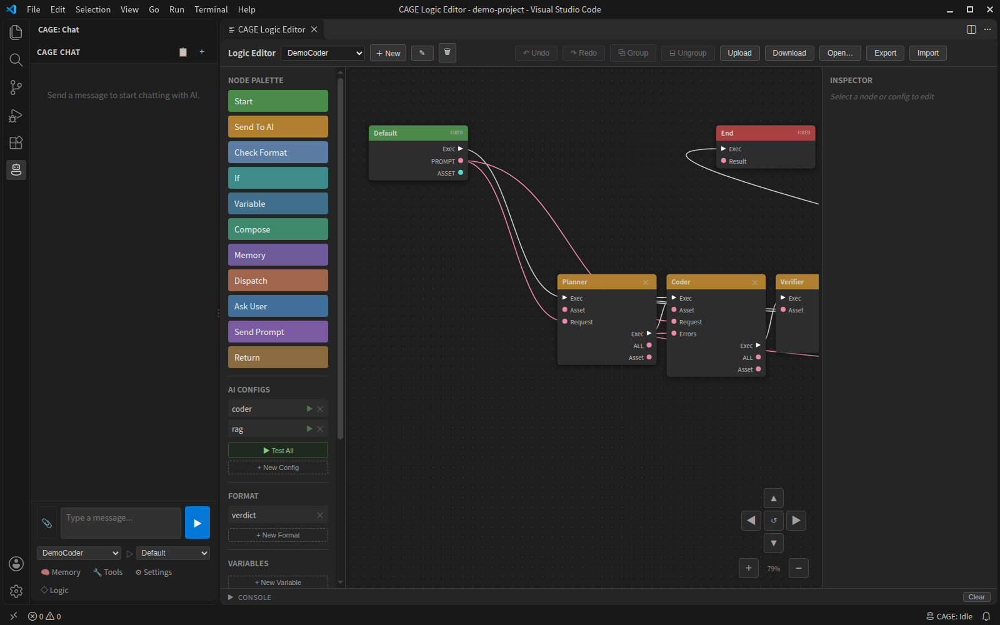
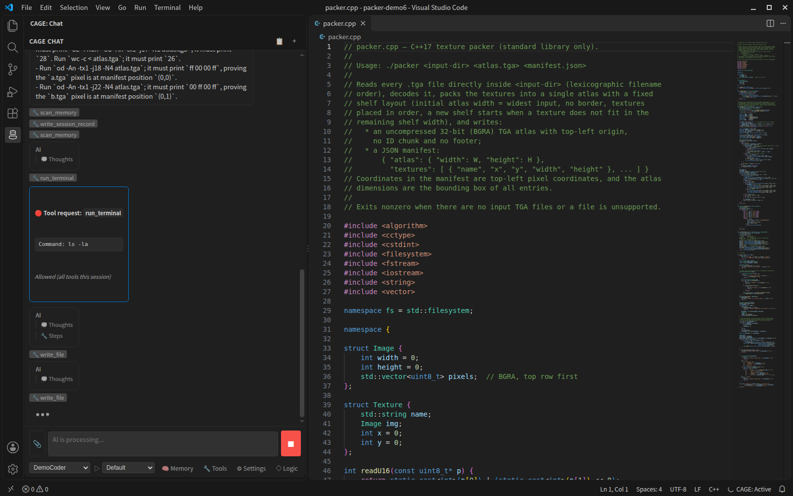

**English** · [繁體中文](README.zh-TW.md)

# CAGE — Composable Agent Graph Engine

**Build your own AI agents by connecting nodes. Language, vision, image, speech,
music, motion and 3D models work together in one graph, on your own GPUs.**

An agent in CAGE is a graph you can see. Each node is one step: ask a model,
check the answer, branch, loop back, split the work, ask you. And each step picks
its own model. One agent can plan with a small fast model, draw with an image
model, speak with a speech model and turn a picture into a 3D mesh, all in one
run. You do not write code, and you do not install Python.

Writing code is one thing you can build with it. It is far from the only one.

> **Proprietary software.** Copyright (c) 2026 real0000. All Rights Reserved.
> This repository distributes compiled packages and documentation; it does not
> contain the source code, and the source code is not for sale.

---

## What you can build

| Agent | How the graph does it |
|---|---|
| **Concept to 3D asset** | Describe an object. An image model draws it, an image-to-3D model turns the picture into a textured `.glb` mesh, and the mesh is saved into your project |
| **Pictures that match the brief** | An image model draws, a vision model compares the picture with the brief, and the graph loops back with what is wrong until they match |
| **Narrated explainer** | A language model writes the script, a speech model reads it aloud, and the audio is saved into your project |
| **Meeting notes from a recording** | Attach a recording. Speech recognition transcribes it, and a language model turns the transcript into decisions and action items |
| **Sound and motion for a game scene** | A music model scores the scene from its description, and a motion model turns "a knight draws his sword and kneels" into an animation clip |
| **A coder that checks its own work** | One model plans, one writes the code, one builds and runs it, one reads the report. Failures go back to the coder with the errors |
| **Research with a second opinion** | Retrieval finds the relevant parts of your project. One model drafts, another critiques, a third decides when the draft is done |
| **Big jobs, split up** | A dispatcher breaks a request into tasks, works through them on parallel branches, and gathers the results |

None of these is a fixed feature. Each is a graph of a handful of nodes: you draw
it once in the Logic Editor, pick it from the chat panel, and change it the moment
it falls short. The [worked example](doc/client/example-graph.md) takes one apart
node by node.

---

## Why CAGE

### Agents are graphs you draw



*The Logic Editor inside VSCode: the node palette and the graph's AI configs on
the left, the graph itself in the middle — here, a coding agent with a check
loop.*

The building blocks:

- **Call a model.** Send To AI calls any model, local or cloud, text or generative.
- **Decide.** If branches on a value. Check Format checks a reply against the
  format you asked for, so a malformed one can be sent back.
- **Loop.** An edge back to an earlier node runs it again, until a check passes.
- **Work in parallel.** Dispatch splits a job into tasks and runs them side by side.
- **Put agents inside agents.** Send Prompt hands a job to another graph and takes
  back its result.
- **Keep a human in the loop.** Ask User pauses the run to put a decision to you.
- **Carry state.** Variables, counters and composed text travel through the run.
- **Get structured answers.** Name the fields you want, and the reply arrives split
  into one pin per field.

Every node picks its own model, quantization, GPUs and sampling parameters. Graphs
are plain JSON, [documented field by field](doc/client/graph-format.md), so a
program, or an AI you ask, can write one without opening the editor.

### Every kind of model, in one graph

| Kind | What a node does with it |
|---|---|
| Language | Plan, write, summarise, judge, call tools |
| Vision | Read the images you attach, or the window of an app it launched |
| Image | Draw from a text prompt |
| Speech | Read text aloud, transcribe a recording, find where someone is talking |
| Music and audio | Compose music from a description, separate a recording into its tracks |
| Motion | Turn a description into an animation clip |
| 3D | Turn a picture into a textured mesh |
| Embedding | Power retrieval over your project |

- **Files flow like text.** The image one node draws is the input of the next.
  A mesh, a voice-over or a track is saved into your project, one approval per
  file.
- **One process, one budget.** Every kind runs inside the server, from the same
  backend pack, on the same GPUs and the same VRAM ledger as the language models.
  No Python, no worker processes, no extra services. An idle image model makes
  room for a chat model, and the other way round.
- **Point at a folder.** The server works out from the weights whether a model
  chats, embeds, draws or builds meshes. There is no list of model types to keep
  up to date.
- **Cloud when you want it.** Any node can call OpenAI, Anthropic or Gemini, or a
  hosted image or speech service (OpenAI, Stability, ElevenLabs, Replicate, fal),
  in the same graph as your local models.

How far each kind has been run on real hardware is listed in
[What has been verified](doc/verification-status.md).

### Your hardware, your models

- **Self-hosted.** The server, the models and everything they produce stay on
  machines you control. A cloud model is used only for the steps you give it.
- **Runs on what you have.** Backend packs cover NVIDIA from Pascal (Tesla P40) to
  Blackwell (RTX 50xx), AMD through ROCm, Intel and others through Vulkan, and
  machines with no GPU. Install several side by side when a machine mixes cards.
- **Multi-GPU without the arithmetic.** You pick the cards; CAGE decides the split
  from the real topology: NVLink islands, free memory per card, dense or
  mixture-of-experts. A 550-billion-parameter model ran correctly on four 32 GB
  V100s, with its experts in host memory.
- **Models share the machine.** They load on first use and make room for each
  other. A reply that runs out of GPU memory part-way waits for room and carries
  on, instead of failing.
- **Hugging Face weights as they are.** Safetensors load directly and are
  quantized to whatever you pick when they load. GGUF files work too, one
  quantization per file.

### Works where you work

- **Inside VSCode.** A chat panel to talk to your agents and choose which graph
  drives the conversation, and the Logic Editor to build them.
- **Tools in your editor, under your control.** Agents read and write files, run
  commands, build and test (CMake, Unity, Unreal, Node, Cargo, Go, Make) and check
  their results with short programs. All of it runs on your machine, and every
  file written is approved first.
- **Bring your own tools.** Attach any MCP program, or define a tool yourself: a
  name, a description, its parameters and one command line.
- **Memory that carries over.** Each file's history, a record of what every step
  did so that a retry knows what the last attempt found, and your own standing
  rules. A small model picks what each step reads. Retrieval over your project
  stays current as you edit.

### Built for teams

- Accounts, access tokens, per-user sessions and usage accounting.
- Graphs private to their owner, or shared with read or write access.
- A web control plane to manage several machines: their models, downloads from
  Hugging Face, and restarts.
- One `docker compose up` for the whole server side.

---

## How it works

```
   VSCode extension ──┐
                      ├── WebSocket + HTTP ──► CAGE Server ──► local models / GPUs
   native client    ──┘                              │
                                                     ├── backend pack (in-process):
                                                     │     text, vision, safetensors,
                                                     │     image, speech, music, motion, 3D
                                                     └── remote chat APIs
```

The server owns everything expensive: model loading and placement, running the
graphs, retrieval, and every kind of model. The client is a thin editor front end
that shows the conversation and runs tool calls on your machine.



*The chat panel runs inside VSCode — here the DemoCoder graph has planned a
texture packer and its coder, Qwen3.8 on four local V100s, has just written
`packer.cpp`. The selector at the bottom picks which logic graph drives the
conversation.*

---

## Licensing

CAGE is sold as a **base product plus separately purchased modules**, and every
product carries **perpetual updates** — buy it once and every future release of
that product is included. No maintenance period, no renewal, no version at which
your licence stops.

A **Commercial Licence** is organisation-wide: install and run it on as many
machines as you like within one company, for your own internal use. No per-seat,
per-GPU or per-server counting.

| | |
|---|---|
| Scope | One legal entity and the entities it controls; unlimited installations |
| Use | Your own internal business purposes, including building your own products |
| Updates | Perpetual. Every future release of what you bought, at no further charge |
| Modules | Major new capabilities are sold separately, each with its own perpetual updates. A module needs a licensed base product to run |
| Not included | Offering CAGE's functionality to third parties as a hosted service, API, or service bureau — that needs a separate agreement |

**A module never takes away what you already bought.** Whatever a product could
do when you licensed it stays part of that product; modules only ever add to it.

Free evaluation builds are available for testing, and may not be used in
production.

Full terms: **[LICENSE](LICENSE)**. Enquiries, including hosted-service and OEM
terms: <https://github.com/real0000>

---

## Get started

| Package | Platform | Contents | Where |
|---|---|---|---|
| `cage-server-0.2.0-linux-x64.tar.gz` | Linux x86-64 | Inference server, node agent, control plane, model downloader | [Releases](../../releases) |
| `cage-backend-*-0.2.0-linux-x64.tar.gz` | Linux x86-64 | **GPU support — one pack for your hardware.** See below | [Releases](../../releases) |
| [`cage-0.2.0.vsix`](dist/cage-0.2.0.vsix) | VSCode ≥ 1.85 | The editor client | `dist/` in this repository |

> **What is on GitHub is the evaluation build.** Releases here carry preview and
> evaluation packages, for trying CAGE out and reporting what breaks. They are
> not the licensed product and are not for production use — see
> [Licensing](#licensing).
>
> Purchases go through Gumroad, which acts as merchant of record, and a licensed
> copy is delivered from there. A purchase carries perpetual updates for that
> product; this repository is not the update channel for it.

**The server package contains no GPU code.** Every local model needs a backend
pack as well — a second download carrying the compiled kernels for your cards.
Pick by compute capability:

| Pack | Hardware |
|---|---|
| `cage-backend-cuda-sm60_sm61` | P40, P100, P4, GTX 10xx |
| `cage-backend-cuda-sm70_sm75` | V100, Titan V, T4, RTX 20xx, GTX 16xx |
| `cage-backend-cuda-sm80_sm86` | A100, A30, A40, A10, RTX 30xx |
| `cage-backend-cuda-sm89_sm90` | L40, L40S, L4, RTX 40xx, H100, H200 |
| `cage-backend-cuda-sm120_sm121` | RTX 50xx, GB10 (DGX Spark) |
| `cage-backend-hip-*` | AMD via ROCm, split by ISA generation (RDNA2/3/4, CDNA) |
| `cage-backend-vulkan` | Any Vulkan 1.2 GPU — AMD, Intel, or NVIDIA |
| `cage-backend-cpu` | No GPU |

You can install several; the server probes each one per card. Without any, the
server still runs, but only `remote` models work. Full detail:
**[Backend Packs](doc/server/server/backend-packs.md)**.

Installation: **[doc/server-install.md](doc/server-install.md)** — Docker or
native — then **[doc/extension-install.md](doc/extension-install.md)** for the
editor client. CAGE ships no ready-made graphs; the
[worked example](doc/client/example-graph.md) is the place to start your first.

### Requirements

| | |
|---|---|
| Server, either way | Linux x86-64, plus a [backend pack](doc/server/server/backend-packs.md) for your GPU. NVIDIA needs only the driver — the packs carry their own CUDA libraries. AMD through the HIP packs or Vulkan, Intel through Vulkan. CPU-only works, slowly |
| …via Docker | Docker with Compose v2, and the NVIDIA Container Toolkit for GPU access. Nothing else on the host |
| …natively | glibc 2.28+ (RHEL / AlmaLinux / Rocky 8, Ubuntu 20.04, Debian 11, Fedora, or newer), PowerShell 7.4+ to run the installer, and MySQL if you want accounts |
| Client | VSCode 1.85+ |

## Documentation

| Document | Contents |
|---|---|
| [WHATSNEW.md](WHATSNEW.md) | **Upgrading from 0.1.x?** What changed, and what needs action from you |
| [doc/verification-status.md](doc/verification-status.md) | **How far each piece has been tested** — and which reports would help most |
| [doc/server-install.md](doc/server-install.md) | **Start here** — Docker or native, then the native path in full: configuration, database, TLS, troubleshooting |
| [doc/server/docker.md](doc/server/docker.md) | The Docker path — one `docker compose up`, with models, database and config as host folders |
| [doc/extension-install.md](doc/extension-install.md) | Installing the `.vsix`, connecting to a server, logging in, first use |
| [doc/server/](doc/server/README.md) | Server guide — node agent, inference server, control plane: what each owns, models, backends, modalities, retrieval, accounts, multi-node |
| [doc/client/](doc/client/README.md) | Client guide — both windows panel by panel, every node type, every configuration parameter, RAG, tools and file approval, all settings |

## License

Proprietary — Copyright (c) 2026 real0000. All Rights Reserved.
Licensed, not sold; no source code is included or sold. See [LICENSE](LICENSE)
for the full terms, and [Licensing](#licensing) above for what a purchase covers.

CAGE incorporates open-source components, all under permissive licences; they
are listed with their copyright notices in
[THIRD-PARTY-NOTICES.md](THIRD-PARTY-NOTICES.md). Model weights are **not**
covered by either document — they are chosen and installed by the operator, and
several carry commercial restrictions. See
[model licences](doc/server/server/models.md#model-licences-are-yours-to-check).
