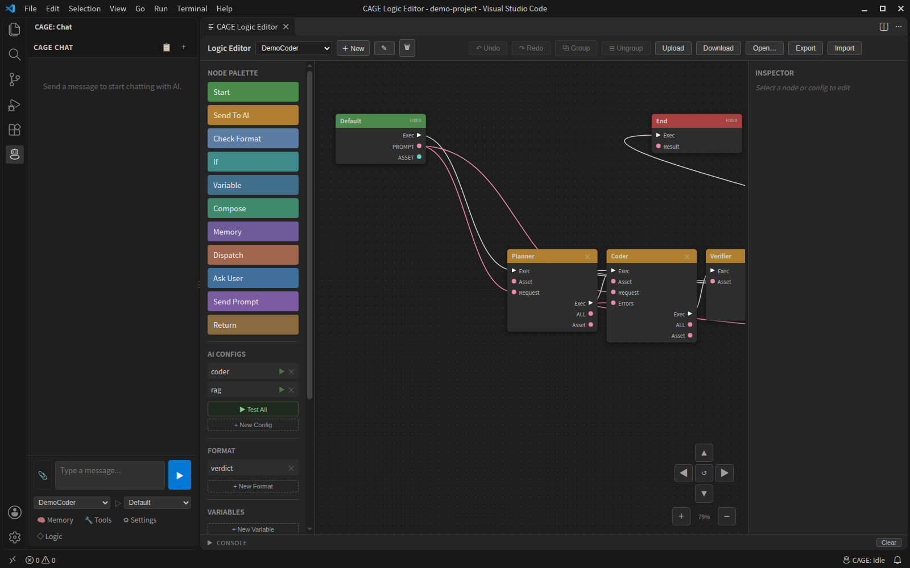
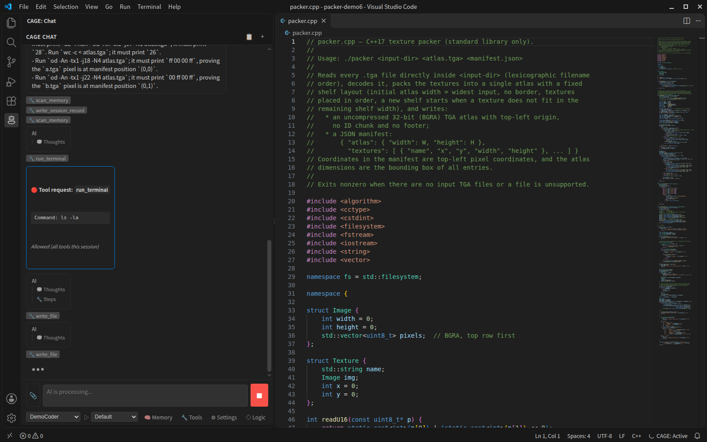

[English](README.md) · **繁體中文**

# CAGE — Composable Agent Graph Engine

**把節點接起來，就能組出你自己的 AI agent。語言、視覺、圖片、語音、音樂、動作和 3D 模型在同一張圖裡分工合作，跑在你自己的 GPU 上。**

在 CAGE 裡，agent 是一張看得見的圖。每個節點是一個步驟：問模型、檢查答案、分支、繞回去重來、把工作拆開、停下來問你。而每個步驟都可以用自己的模型。同一個 agent 可以用小而快的模型規劃、用圖片模型畫圖、用語音模型開口說話，再把一張圖變成 3D 網格，一次執行全部做完。不用寫程式，也不用裝 Python。

寫程式只是它能做的其中一件事，遠遠不是唯一的一件。

> **專有軟體。** Copyright (c) 2026 real0000. All Rights Reserved.
> 這個 repository 發行的是編譯好的套件與文件，不含原始碼，原始碼也不出售。

---

## 能做出什麼

| Agent | 圖怎麼做到 |
|---|---|
| **從概念到 3D 素材** | 描述一個物件。圖片模型把它畫出來，圖片轉 3D 的模型再把這張圖變成帶貼圖的 `.glb` 網格，存進你的專案 |
| **符合需求的圖片** | 圖片模型畫圖，視覺模型拿圖跟需求比對，不符合就帶著哪裡不對繞回去重畫，直到符合為止 |
| **有旁白的解說** | 語言模型寫稿，語音模型把稿子唸出來，音檔存進你的專案 |
| **從錄音整理會議紀錄** | 附上一段錄音。語音辨識把它轉成文字，語言模型再從逐字稿整理出決議和待辦事項 |
| **遊戲場景的配樂與動作** | 音樂模型依場景描述配樂，動作模型把「騎士拔劍、單膝跪下」變成一段動畫 |
| **會自己檢查成果的 coder** | 一個模型規劃、一個寫程式、一個實際建置並執行、一個讀報告下判斷。沒過就帶著錯誤送回去重寫 |
| **有第二意見的研究** | 檢索找出專案裡相關的部分。一個模型起草、一個挑毛病、一個決定什麼時候算完成 |
| **把大工作拆開做** | 一個 dispatcher 把要求拆成幾項工作，在平行的分支上逐項完成，再把結果收齊 |

這些都不是寫死的功能。每一個都是幾個節點組成的圖：在 Logic Editor 裡畫一次，到 chat panel 選它，哪裡不夠好就馬上改。[完整範例](doc/client/example-graph.zh-TW.md)把其中一張一個節點一個節點拆開來說明。

---

## 為什麼選 CAGE

### agent 就是你畫出來的圖



*VSCode 裡的 Logic Editor：左邊是節點面板和這張圖用到的 AI configs，中間是圖本身 —— 這裡是一個會自我檢查的 coding agent。*

組 agent 用的積木：

- **呼叫模型。** Send To AI 可以呼叫任何模型：本機或雲端、文字或生成式。
- **做判斷。** If 依一個值分支。Check Format 檢查回答是不是你要的格式，格式不對就能送回去重來。
- **迴圈。** 接回前面節點的連線會讓它再跑一次，直到檢查通過。
- **平行處理。** Dispatch 把一件工作拆成幾項，同時進行。
- **agent 裡還有 agent。** Send Prompt 把工作交給另一張圖，再把結果拿回來。
- **讓人參與決定。** Ask User 會暫停執行，把決定交給你。
- **帶著狀態走。** 變數、計數器和組合好的文字，在整次執行中一路帶著。
- **結構化的回答。** 列出你要的欄位，回答進來時就已經拆好，一個欄位一個 pin。

每個節點都能自己選模型、量化、GPU 和取樣參數。圖是純 JSON，[每個欄位都有文件](doc/client/graph-format.zh-TW.md)，所以程式 —— 或你請來幫忙的 AI —— 不打開編輯器也寫得出一張圖。

### 各種模型，放進同一張圖

| 種類 | 節點拿它做什麼 |
|---|---|
| 語言 | 規劃、寫作、摘要、評判、呼叫工具 |
| 視覺 | 看你附上的圖片，或它啟動的應用程式視窗 |
| 圖片 | 依文字描述畫圖 |
| 語音 | 把文字唸出來、把錄音轉成文字、找出錄音裡有人說話的片段 |
| 音樂與音訊 | 依描述作曲、把一段錄音分離成各個音軌 |
| 動作 | 把一段描述變成動畫 |
| 3D | 把一張圖變成帶貼圖的網格 |
| Embedding | 支撐對你專案的檢索 |

- **檔案跟文字一樣在圖裡流動。** 一個節點畫出來的圖，就是下一個節點的輸入。網格、旁白或配樂會存進你的專案，每個檔案各核准一次。
- **一個程序，一本帳。** 每一種模型都在 server 裡面執行，跟語言模型用同一個後端包、同樣的 GPU、同一本 VRAM 帳本。沒有 Python、沒有 worker 程序，也不用另外架服務。閒著的圖片模型會讓位給聊天模型，反過來也一樣。
- **指向資料夾就好。** server 從權重判斷一個模型是聊天、embedding、畫圖還是做網格。沒有一份模型種類清單要你維護。
- **想用雲端也可以。** 任何節點都能改呼叫 OpenAI、Anthropic 或 Gemini，或代管的圖片、語音服務（OpenAI、Stability、ElevenLabs、Replicate、fal），跟你的本機模型放在同一張圖裡。

每一種模型在真實硬體上跑到什麼程度，列在[驗證過什麼](doc/verification-status.zh-TW.md)。

### 你的硬體，你的模型

- **自己架設。** server、模型和它們產出的一切，都留在你掌控的機器上。雲端模型只用在你指定給它的步驟。
- **有什麼硬體就用什麼。** 後端包涵蓋 NVIDIA 從 Pascal（Tesla P40）到 Blackwell（RTX 50xx）、透過 ROCm 的 AMD、透過 Vulkan 的 Intel 與其他 GPU，以及沒有 GPU 的機器。一台機器混用不同的卡時，可以並排裝好幾個後端包。
- **多 GPU，不用自己算。** 你挑卡，CAGE 依實際的拓樸決定怎麼切：NVLink 分成哪幾座島、每張卡還剩多少記憶體、模型是 dense 還是 mixture-of-experts。一個 5500 億參數的模型，曾在四張 32 GB 的 V100 上正確執行，專家層放在主機記憶體裡。
- **模型共用一台機器。** 第一次用到才載入，空間不夠時會互相讓位。回答到一半 GPU 記憶體不夠，會等到有空間再接著做，而不是失敗。
- **Hugging Face 的權重直接用。** safetensors 直接載入，載入時量化成你選的格式。GGUF 檔也能用，一個檔案就是一種量化。

### 在你工作的地方運作

- **就在 VSCode 裡。** chat panel 用來跟你的 agent 對話、選由哪一張圖來驅動對話，Logic Editor 用來組 agent。
- **工具在你的編輯器裡執行，由你掌控。** agent 能讀寫檔案、執行指令、建置與測試（CMake、Unity、Unreal、Node、Cargo、Go、Make），並用小程式檢查自己的結果。全部在你的機器上執行，每個要寫入的檔案都先經過你核准。
- **帶上你自己的工具。** 接上任何 MCP 程式，或自己定義一個工具：名字、說明、參數，加上一行指令。
- **記憶會延續下去。** 每個檔案的修改歷史、每一步做了什麼的紀錄（重試時知道上一次查到了什麼），以及你自己定的長期規則；由一個小模型挑出每一步要讀哪些。對專案的檢索會隨著你的編輯保持最新。

### 為團隊而做

- 帳號、存取權杖、每個使用者各自的 session 與用量計算。
- 圖可以只屬於擁有者，也可以分享給別人讀或寫。
- 網頁控制台管理多台機器：各自的模型、從 Hugging Face 下載，以及重新啟動。
- 一個 `docker compose up` 就架好整個 server 端。

---

## 運作方式

```
   VSCode extension ──┐
                      ├── WebSocket + HTTP ──► CAGE Server ──► local models / GPUs
   native client    ──┘                              │
                                                     ├── backend pack (in-process):
                                                     │     text, vision, safetensors,
                                                     │     image, speech, music, motion, 3D
                                                     └── remote chat APIs
```

所有吃資源的工作都在 server：模型的載入與擺放、執行邏輯圖、檢索，以及每一種模型。client 是一層薄薄的編輯器前端，負責顯示對話，並在你的電腦上執行工具呼叫。



*chat panel 就在 VSCode 裡。圖中 DemoCoder 這張圖剛規劃好一個 texture packer，負責寫程式的 coder（四張本機 V100 上的 Qwen3.8）剛寫完 `packer.cpp`。底部的選單決定由哪一張邏輯圖來驅動這段對話。*

---

## 授權

CAGE 以**基本產品，加上另外購買的模組**的方式販售，每個產品都附**永久更新**：買一次，這個產品之後的每一個版本都包含在內。沒有維護期、不用續約，也不會到了哪個版本授權就停止。

**商業授權**以組織為單位：在同一家公司內，要裝幾台機器、跑幾份都可以，供自己內部使用。不按座位、GPU 或伺服器數量計算。

| | |
|---|---|
| 範圍 | 一個法人，以及它所控制的法人；安裝數量不限 |
| 用途 | 你自己的內部業務，包括開發你自己的產品 |
| 更新 | 永久。你買的產品之後的每一個版本，都不另外收費 |
| 模組 | 重大的新功能另外販售，各自附永久更新。模組要搭配已授權的基本產品才能使用 |
| 不包含 | 把 CAGE 的功能以代管服務、API 或代工服務的形式提供給第三方 —— 這需要另外簽約 |

**模組不會拿走你已經買到的東西。** 授權當時產品做得到的事，永遠是那個產品的一部分；模組只會往上加。

另外有免費的評估版可以測試，但不能用在正式環境。

完整條款：**[LICENSE](LICENSE)**。洽詢（包括代管服務與 OEM 條款）：<https://github.com/real0000>

---

## 開始使用

| 套件 | 平台 | 內容 | 位置 |
|---|---|---|---|
| `cage-server-0.2.0-linux-x64.tar.gz` | Linux x86-64 | 推論伺服器、節點代理、控制台、模型下載器 | [Releases](../../releases) |
| `cage-backend-*-0.2.0-linux-x64.tar.gz` | Linux x86-64 | **GPU 支援：依你的硬體挑一包。** 見下方 | [Releases](../../releases) |
| [`cage-0.2.0.vsix`](dist/cage-0.2.0.vsix) | VSCode ≥ 1.85 | 編輯器 client | 這個 repository 的 `dist/` |

> **GitHub 上的是評估版。** 這裡的 Releases 放的是預覽與評估用的套件，讓你試用 CAGE、回報哪裡壞了。它們不是授權產品，也不能用在正式環境，見[授權](#授權)。
>
> 購買透過 Gumroad（由它擔任登記商家），授權版本也從那裡交付。購買附帶該產品的永久更新；這個 repository 不是它的更新管道。

**server 套件裡沒有任何 GPU 程式碼。** 每個本機模型都還需要一個後端包：另一個下載檔，裡面是替你的顯示卡編譯好的 kernel。依 compute capability 挑選：

| 後端包 | 硬體 |
|---|---|
| `cage-backend-cuda-sm60_sm61` | P40、P100、P4、GTX 10xx |
| `cage-backend-cuda-sm70_sm75` | V100、Titan V、T4、RTX 20xx、GTX 16xx |
| `cage-backend-cuda-sm80_sm86` | A100、A30、A40、A10、RTX 30xx |
| `cage-backend-cuda-sm89_sm90` | L40、L40S、L4、RTX 40xx、H100、H200 |
| `cage-backend-cuda-sm120_sm121` | RTX 50xx、GB10（DGX Spark） |
| `cage-backend-hip-*` | AMD（透過 ROCm），依 ISA 世代分包（RDNA2／3／4、CDNA） |
| `cage-backend-vulkan` | 任何支援 Vulkan 1.2 的 GPU：AMD、Intel 或 NVIDIA |
| `cage-backend-cpu` | 沒有 GPU |

可以同時裝好幾包，server 會逐張卡探測每一包。一包都沒裝的話 server 照樣能跑，但只有 `remote` 模型能用。完整說明：**[後端包](doc/server/server/backend-packs.zh-TW.md)**。

安裝：先看 **[doc/server-install.zh-TW.md](doc/server-install.zh-TW.md)**（Docker 或原生安裝），再看編輯器 client 的 **[doc/extension-install.zh-TW.md](doc/extension-install.zh-TW.md)**。CAGE 沒有附現成的圖；你的第一張圖，可以從[完整範例](doc/client/example-graph.zh-TW.md)開始。

### 需求

| | |
|---|---|
| Server（兩種裝法都需要） | Linux x86-64，加上符合你 GPU 的[後端包](doc/server/server/backend-packs.zh-TW.md)。NVIDIA 只要裝驅動程式，後端包自帶 CUDA 函式庫。AMD 用 HIP 後端包或 Vulkan，Intel 用 Vulkan。純 CPU 也能跑，只是慢 |
| …用 Docker | Docker 加 Compose v2；要用 GPU 還需要 NVIDIA Container Toolkit。主機上不必裝別的 |
| …原生安裝 | glibc 2.28 以上（RHEL／AlmaLinux／Rocky 8、Ubuntu 20.04、Debian 11、Fedora，或更新的版本）；執行安裝程式需要 PowerShell 7.4 以上；要用帳號功能的話還需要 MySQL |
| Client | VSCode 1.85 以上 |

## 文件

| 文件 | 內容 |
|---|---|
| [WHATSNEW.zh-TW.md](WHATSNEW.zh-TW.md) | **從 0.1.x 升級？** 改了什麼、哪些需要你動手處理 |
| [doc/verification-status.zh-TW.md](doc/verification-status.zh-TW.md) | **每個部分測試到什麼程度**，以及哪些回報最有幫助 |
| [doc/server-install.zh-TW.md](doc/server-install.zh-TW.md) | **從這裡開始**：選 Docker 或原生安裝，接著完整說明原生安裝的設定、資料庫、TLS 與疑難排解 |
| [doc/server/docker.zh-TW.md](doc/server/docker.zh-TW.md) | Docker 安裝：一個 `docker compose up`，模型、資料庫和設定都是主機上的資料夾 |
| [doc/extension-install.zh-TW.md](doc/extension-install.zh-TW.md) | 安裝 `.vsix`、連上 server、登入、第一次使用 |
| [doc/server/](doc/server/README.zh-TW.md) | Server 指南：節點代理、推論伺服器、控制台各自負責什麼；模型、後端、modality、檢索、帳號、多節點 |
| [doc/client/](doc/client/README.zh-TW.md) | Client 指南：兩個視窗逐一面板說明、每一種節點、每一個設定參數、RAG、工具與檔案核准、所有設定 |

## 授權條款

專有軟體 —— Copyright (c) 2026 real0000. All Rights Reserved.
以授權方式提供，不是販售；不包含、也不出售原始碼。完整條款見 [LICENSE](LICENSE)，購買涵蓋哪些內容見上方的[授權](#授權)。

CAGE 使用了一些開放原始碼元件，全部採用寬鬆授權，連同各自的著作權聲明列在 [THIRD-PARTY-NOTICES.md](THIRD-PARTY-NOTICES.md)。模型權重**不在**這兩份文件的範圍內：權重由營運者自行挑選、安裝，其中好幾個有商業使用上的限制。見[模型授權](doc/server/server/models.zh-TW.md#模型授權要自己確認)。
