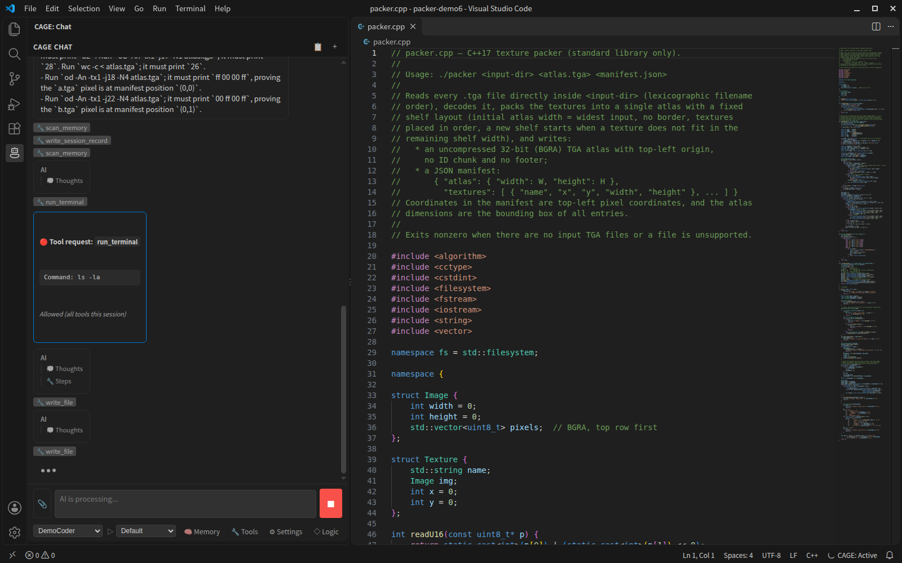

[English](README.md) · **繁體中文**

# Client 指南

CAGE client 是一個 VSCode extension。它裡面沒有模型，也不做推論：跟模型有關的決定全部屬於 server 與邏輯圖。client 做的事是讓你看到對話、讓你設計 agent 的行為，以及在你的編輯器裡、經過你核准後，執行模型要求的工具呼叫。

安裝另外寫在 [extension-install.zh-TW.md](../extension-install.zh-TW.md)。

---

## 兩個視窗



### [Chat Panel →](chat-panel.zh-TW.md)

平常用的視窗：送出訊息、看著回答一路串流進來、核准工具呼叫、切換 session、瀏覽歷史紀錄。底部的選單決定由*哪一張*邏輯圖回答你，以及這一輪從圖中的*哪裡*開始。

### [Logic Editor →](logic-editor.zh-TW.md)

驅動 agent 的那張圖的視覺化編輯器。節點是步驟，連線是順序，左側面板放著這些節點會引用的、可以重複使用的設定。CAGE 跟一般聊天 extension 最不一樣的地方就在這裡：agent 迴圈是你可以編輯的資料，不是只能接受的程式碼。

---

## 哪些內容在哪一頁

| 主題 | 內容 |
|---|---|
| [Chat Panel](chat-panel.zh-TW.md) | 送出訊息、session、歷史紀錄、Graph 與 Start 選單、狀態標籤 |
| [Logic Editor](logic-editor.zh-TW.md) | 畫布、節點面板、inspector、工具列、console、群組 |
| [節點](nodes.zh-TW.md) | 每一種節點：它做什麼、它的 pin、它的設定 |
| [AI Configs](ai-config.zh-TW.md) | 模型、量化、GPU 擺放、context、取樣：每一個參數，以及它什麼時候生效 |
| [Modality Configs](modality-config.zh-TW.md) | AI Configs 清單裡生成式的那一半：圖像、語音、音訊、音樂、3D，本機模型與遠端服務 |
| [Format Configs](format-config.zh-TW.md) | 結構化輸出的 schema 與輸出驗證 |
| [變數](variables.zh-TW.md) | 屬於整張圖、在同一輪執行中跨節點保留的狀態 |
| [邏輯圖檔案格式](graph-format.zh-TW.md) | 一張圖存成的 JSON，詳細到不用編輯器也能寫出一張 |
| [完整範例](example-graph.zh-TW.md) | 從頭到尾走一遍 `DemoCoder`：它設定的每個參數與理由，以及設錯時不會報錯、只會默默失敗的三個設定 |
| [專案記憶](memory.zh-TW.md) | 依檔案自動寫下的歷史、目前這段對話的紀錄、你自己的規則，以及記憶 AI 怎麼挑出一個步驟要讀的內容 |
| [RAG](rag.zh-TW.md) | 對你的專案做檢索：哪些東西會被索引、節點怎麼使用它 |
| [Tools](tools.zh-TW.md) | 一張表收錄模型能呼叫的所有工具：內建的、你自己寫的、MCP 程式；group、核准、自訂行為 |
| [檔案核准](file-approval.zh-TW.md) | 每一次寫檔怎麼在寫入之前個別核准 |
| [MCP 程式](mcp.zh-TW.md) | 掛上一組現成的工具：傳輸方式、設定、疑難排解 |
| [專案索引](indexing.zh-TW.md) | client 把什麼送給 server、什麼時候送 |
| [設定](settings.zh-TW.md) | 每一個 `cage.*` 設定 |

---

## 一則訊息實際上怎麼流動

值得讀一次，這份指南其他部分都假設你知道這個流程。

```
你在 Chat Panel 打一則訊息
        │
        │  訊息裡帶著你選的邏輯圖，以及你選的 Start 節點
        ▼
   Start ──► SendToAi ──► CheckFormat ──► … ──► End
                │              │
                │              └─ 驗證回答，分成 True／False 兩條路
                │
                └─ 模型要求使用工具 ──► client 在 VSCode 裡執行
                   （讀檔、套用 patch、執行指令）──► 結果送回模型，
                   模型接著往下做
```

server 執行這張圖。client 提供 prompt、回應工具呼叫，並顯示串流回來的所有內容。每一則訊息都會指明由哪一張圖執行；沒有選圖的話，server 會回一個錯誤，而不是執行一張你沒選的圖。

工具寫的每一個檔案，都會在寫進你的工作區之前個別核准，見[檔案核准](file-approval.zh-TW.md)。

---

專有軟體 —— Copyright (c) 2026 real0000. All Rights Reserved. 見 [LICENSE](../../LICENSE)。
