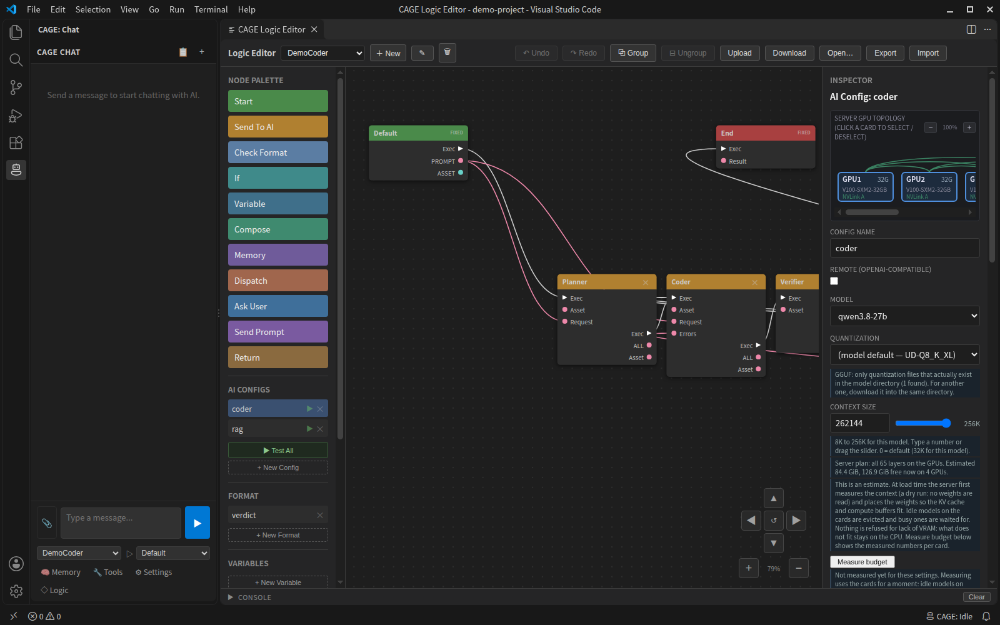

# AI Configs

An AI config is a named bundle of "which model, loaded how, sampled how". Nodes
reference it by name, so several [Send To AI](nodes.md#send-to-ai) nodes can
share one config, and one graph can mix a small fast model for routine steps
with a large one for the hard step.

Configs live in the **AI CONFIGS** section of the Logic Editor sidebar — one
list holding both text models and the generative ones (image, speech, audio,
music, 3D). The property sheet changes to match the model you pick; the
generative fields are described in [Modality Configs](modality-config.md).

*Selecting a config opens it in the Inspector. The GPU picker at the top shows
the server's actual cards and how they are linked; the fields below it are
described on this page, each with the warning that applies to it.*

---

## When a change takes effect

The single most useful thing to understand here. There are three kinds of
parameter, decided by what the server does with each.

**Load-time** parameters are fixed the moment the model's weights are loaded.
A model is loaded once, so requests that differ in one of these cannot share the
loaded copy: the server waits until nothing is using it, unloads it and loads
the model again with the new values. A change takes effect from the next run; a
run already in progress finishes with the values it started with.

**Per-context** parameters apply when a context is created, not when the
weights load. Requests with different values each get their own context on the
same loaded model, with no reload — unless a card cannot hold the context asked
for, in which case the server plans the placement again.

**Per-request** parameters go out with every inference call and take effect
immediately.

| Scope | Parameters |
|---|---|
| Load-time | Quantization, GPU Layers, Split Mode, CPU MoE Layers, Auto Fit, Lookahead Decoding, MTP Decoding, GPU Visibility |
| Per-context | Context Size, Prompt Batch Size, Threads, Flash Attention, KV Cache Type |
| Per-request | Temperature, Top K, Top P, Presence Penalty, Reasoning Budget |

The editor's console says which kind a parameter is when you change it.

## Model

| Field | Meaning |
|---|---|
| Model | Picked from what the server reports. The server scans each model directory listed in its `config.xml` |
| Quantization | Which quantization to load |

Quantization behaves differently by format, because the server treats a model's
path as a *directory*:

- **GGUF** — every `.gguf` file in the directory is one quantization. You can
  only choose one that is actually there; adding another means downloading that
  file into the same directory. No config change needed.
- **safetensors** — the weights are one set and are quantized while they load,
  so the whole list is available: 4bit (Q4_K_M), 8bit (Q8_0), bf16, fp16, fp32.
  `4bit-fp4` is accepted from older configurations and loads as 4bit.

Leave it empty to use the model's default — the one named in the server's
`config.xml`, or the smallest one found.

## Remote endpoints

Switch a config to **remote** to call an OpenAI-compatible endpoint instead of a
local model.

| Field | Meaning |
|---|---|
| Remote URL | Base URL with no trailing slash, e.g. `https://api.openai.com` or `http://localhost:11434/v1` |
| API Key | Sent as `Authorization: Bearer …` when set |
| Model | The remote model ID, as a free string |

In remote mode the server loads nothing locally and every load-time parameter
below is ignored. The test button checks `/v1/models`; inference posts to
`/v1/chat/completions`.

## Context and batching

| Field | Default | Meaning |
|---|---|---|
| Context Size | 0 | Context window in tokens. `0` means the default: 32K, or the longest the model allows if that is shorter. The editor offers 8K up to the longest the server reports for the model. It decides how large the KV cache is |
| Prompt Batch Size | 0 | Tokens per prompt-processing batch. `0` uses the backend default (2048) |
| Threads | 0 | CPU threads for inference. `0` lets the backend decide from the core count |
| Flash Attention | on | Faster attention with a smaller KV cache footprint |
| KV Cache Type | `f16` | KV cache precision: `f16`, `q8_0`, `q4_0`. Quantizing the cache buys context length at some quality cost |

Context size interacts with everything else: a long context reserves a large KV
cache, which is often what pushes a model out of VRAM.

## GPU placement

This is where a model that "does not fit" usually becomes one that does.

| Field | Default | Meaning |
|---|---|---|
| Auto Fit | on | Let the server decide placement — see below |
| GPU Visibility | empty | Which GPUs this config may use, ticked in the topology picker and stored as GPU UUIDs. Empty means every GPU the server sees |
| GPU Layers | -1 | Only with Auto Fit off. Layers to put on the GPUs: `-1` places as many as fit and offloads the rest to the CPU, `0` is CPU-only |
| Split Mode | `layer` | Only with Auto Fit off. `layer` splits by layer, `row` is the older row split (tensor parallelism where supported), `tensor` is the newer meta-device split (experimental, architecture-dependent), `none` keeps the whole model on one GPU |
| CPU MoE Layers | 0 | Only with Auto Fit off. For mixture-of-experts models, keep expert weights on the CPU: `0` off, `N` for the first N layers, `-1` for all. Non-MoE models ignore it |

**Auto Fit** is the default and the recommended setting. You choose which GPUs
may be used; the server decides how. It groups those GPUs into NVLink islands,
estimates the weights, KV cache and compute buffers, and then: the whole model
fits one card → that card; one island → a `graph` split, tensor parallelism
across every card; several equal-sized islands → tensor parallelism inside each
island and a pipeline between them; otherwise → a `layer` split. Whatever does
not fit is offloaded to the CPU by MoE expert.

Compute buffers are measured when each context is created. If a card cannot hold
one, idle models on it are evicted and busy ones are waited for; failing that,
the model computes partly on the CPU, or is loaded again with less of it on the
GPU. **Nothing is refused for lack of VRAM**, and Context Size is never quietly
reduced. While Auto Fit is on, GPU Layers, Split Mode and CPU MoE Layers are
decided by the server and hidden in the editor.

**`-1` can quietly mean CPU.** With Auto Fit off, on a machine where this backend
has no usable GPU, `-1` resolves to 0 and the model loads entirely on the CPU —
no error, just far slower. Auto Fit reports its plan in the console instead.

**GPU Visibility picks the cards this config may use.** The restriction is applied
where placement is decided, so a card you leave out is never touched. Use it to
keep a model off a display card, or off one another model is holding. With Auto
Fit on, the list is a set: the same cards in another order are the same placement
and do not cause a reload.

**If none of the cards it names is on this machine**, the request fails and says
so — a card that has dropped off the bus, or a config written on another machine.
Other cards are never used in their place. The same holds for embedding models.

## Decoding

| Field | Default | Meaning |
|---|---|---|
| Lookahead Decoding | off | Self-speculative decoding with no draft model. It trades extra computation for fewer steps, so it only takes effect while the whole model is on the GPU; otherwise the server decodes normally and logs why. Measure before relying on it — on the V100s it was slower in every configuration tried |
| MTP Decoding | off | Uses the model's own multi-token-prediction head to draft several tokens per step. The model needs one: inside its GGUF, or published as a separate predictor-only GGUF in the model's directory (exactly one). Models without a head decode normally. Cannot be combined with Lookahead, which wins |
| Reasoning Budget | -1 | For models that think before answering: `-1` no limit, `0` closes the reasoning block at once, `N` stops thinking after N tokens. The answer itself is never limited. Remote endpoints only receive it on the OpenAI family |

Neither speculative method changes what the model would say in distribution, but
neither guarantees identical text either, even at temperature 0: verifying several
positions at once runs different GPU kernels, and near-ties can flip.

## Sampling

| Field | Meaning |
|---|---|
| Temperature | Randomness. Lower is more deterministic |
| Top K | Sample only from the K most likely tokens |
| Top P | Sample from the smallest set of tokens whose probability sums to P |
| Presence Penalty | Lowers the score of every token that has already appeared in the reply, once, however often it appeared — the OpenAI definition, counted over the whole reply so far, reasoning included, not the prompt. `0` (the default) is off. Reasoning models use it against endless repetition in their thinking. Ignored while Lookahead Decoding is on. Remote endpoints only receive it on the OpenAI family |

Use the values the model's own card recommends — they differ between models
and between thinking and non-thinking use. Qwen3.6, for example, recommends
temperature 1.0, Top P 0.95, Top K 20 and presence penalty 1.5 for thinking on
general tasks, and says the penalty can go up to 2 against endless repetition,
at the risk of mixed languages and slightly worse answers; Qwen3.8 recommends
the same values with presence penalty 0.

These are per-request, so editing them affects the very next call. Reasoning
Budget, above, is too.

## Testing a config

Each config has a ▶ button, and **Test All** runs every one.

The test runs in two stages: first it validates the settings, then it actually
loads the model with them. That second stage is the point — it is how you find
out whether a placement fits in VRAM without discovering it halfway through a
real run. Results, warnings and licence notes appear in the editor's console.

## Licence flags

The server records the upstream licence of each model. Configs pointing at a
model with commercial restrictions are flagged in the console, with the
restriction spelled out and a link to the model card. Models are marked free,
restricted, or non-commercial.

---

[← Logic Editor](logic-editor.md) · [Modality Configs](modality-config.md) · [Client Guide](README.md)
