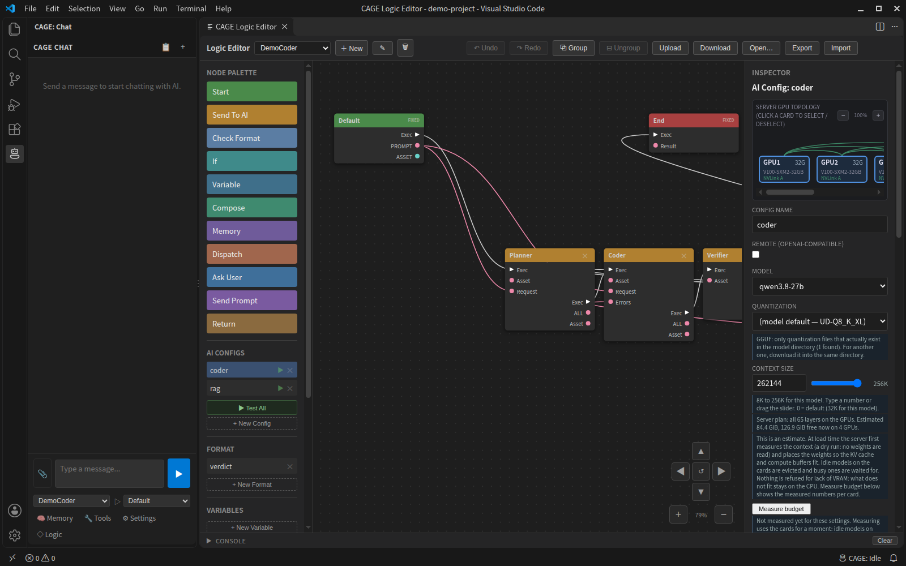

[English](ai-config.md) · **繁體中文**

# AI Configs

AI config 是一組有名字的設定：「用哪個模型、怎麼載入、怎麼取樣」。節點依名字引用它，所以好幾個 [Send To AI](nodes.zh-TW.md#send-to-ai) 節點可以共用一個 config，同一張圖也可以混用：例行的步驟用又小又快的模型，困難的那一步用大模型。

config 放在 Logic Editor 側欄的 **AI CONFIGS** 區塊裡 —— 一份清單同時放文字模型和生成式模型（圖像、語音、音訊、音樂、3D）。屬性表會隨你選的模型改變；生成式模型的欄位寫在 [Modality Configs](modality-config.zh-TW.md)。

*選取一個 config，它就會在 Inspector 裡打開。最上面的 GPU 選擇器顯示 server 實際有哪些卡、彼此怎麼連接；下面的欄位都在這一頁說明，各自附上適用的提醒。*

---

## 改了什麼時候生效

這裡最值得弄懂的一件事。參數分成三種，取決於 server 怎麼使用它。

**載入時**的參數，在模型權重載入的那一刻就固定了。一個模型只載入一次，所以這類參數不同的請求不能共用已經載入的那一份：server 會等到沒有人在用它，卸載，再用新的值重新載入。改動從下一輪開始生效；已經在跑的那一輪，會用它開始時的值跑完。

**每個 context** 的參數在建立 context 時套用，不是在權重載入時。值不同的請求，會在同一個已載入的模型上各自拿到自己的 context，不用重新載入 —— 除非某張卡放不下要求的 context，那時 server 會重新規劃擺放。

**每個請求**的參數隨著每一次推論呼叫送出，立刻生效。

| 範圍 | 參數 |
|---|---|
| 載入時 | Quantization、GPU Layers、Split Mode、CPU MoE Layers、Auto Fit、Lookahead Decoding、MTP Decoding、GPU Visibility |
| 每個 context | Context Size、Prompt Batch Size、Threads、Flash Attention、KV Cache Type |
| 每個請求 | Temperature、Top K、Top P、Presence Penalty、Reasoning Budget |

你改參數時，編輯器的 console 會說明它屬於哪一種。

## 模型

| 欄位 | 意思 |
|---|---|
| Model | 從 server 回報的清單裡挑。server 會掃描它 `config.xml` 裡列出的每個模型資料夾 |
| Quantization | 要載入哪一個量化版本 |

量化的行為依格式而不同，因為 server 把模型的路徑當作一個*資料夾*：

- **GGUF**：資料夾裡每一個 `.gguf` 檔就是一個量化版本。只能選真的存在的；要多一個，就把那個檔案下載到同一個資料夾。不用改 config。
- **safetensors**：權重只有一份，在載入時才量化，所以整份清單都能選：4bit（Q4_K_M）、8bit（Q8_0）、bf16、fp16、fp32。舊設定裡的 `4bit-fp4` 仍然接受，會以 4bit 載入。

留空就用模型的預設值：server `config.xml` 裡指定的那一個，沒指定的話就是找到的最小那一個。

## 遠端端點

把 config 切換成 **remote**，就會改呼叫一個 OpenAI 相容的端點，而不是本機模型。

| 欄位 | 意思 |
|---|---|
| Remote URL | 基底 URL，結尾不要加斜線，例如 `https://api.openai.com` 或 `http://localhost:11434/v1` |
| API Key | 有填的話，以 `Authorization: Bearer …` 送出 |
| Model | 遠端的模型 ID，自由輸入的字串 |

在 remote 模式下，server 不會在本機載入任何東西，下面所有載入時的參數都會被忽略。測試按鈕檢查的是 `/v1/models`；推論則送到 `/v1/chat/completions`。

## Context 與批次

| 欄位 | 預設值 | 意思 |
|---|---|---|
| Context Size | 0 | context 視窗大小，以 token 計。`0` 表示用預設值：32K，如果模型允許的最長值更短就用那個。編輯器提供從 8K 到 server 回報的這個模型最長值之間的選項。它決定 KV cache 有多大 |
| Prompt Batch Size | 0 | 處理 prompt 時每一批幾個 token。`0` 用後端的預設值（2048） |
| Threads | 0 | 推論用幾個 CPU 執行緒。`0` 讓後端依核心數決定 |
| Flash Attention | on | 比較快的 attention，KV cache 占用也比較小 |
| KV Cache Type | `f16` | KV cache 的精度：`f16`、`q8_0`、`q4_0`。量化 cache 能換到更長的 context，代價是一些品質 |

context 的大小會影響其他所有東西：長的 context 會保留很大的 KV cache，而這往往就是把模型擠出 VRAM 的原因。

## GPU 擺放

「放不下」的模型，通常就是在這裡變成放得下的。

| 欄位 | 預設值 | 意思 |
|---|---|---|
| Auto Fit | on | 讓 server 決定擺放，見下方 |
| GPU Visibility | 空白 | 這個 config 可以用哪些 GPU，在拓樸選擇器裡勾選，存成 GPU UUID。空白表示 server 看得到的每一張 GPU |
| GPU Layers | -1 | 只在 Auto Fit 關閉時有效。要放到 GPU 上的層數：`-1` 放得下多少就放多少、其餘放到 CPU，`0` 是純 CPU |
| Split Mode | `layer` | 只在 Auto Fit 關閉時有效。`layer` 依層切分；`row` 是比較舊的列切分（支援的地方就是 tensor parallelism）；`tensor` 是比較新的 meta-device 切分（實驗性質，依架構而定）；`none` 把整個模型放在一張 GPU 上 |
| CPU MoE Layers | 0 | 只在 Auto Fit 關閉時有效。mixture-of-experts 模型的專家權重留在 CPU：`0` 關閉，`N` 前 N 層，`-1` 全部。不是 MoE 的模型會忽略它 |

**Auto Fit** 是預設值，也是建議的設定。你選擇可以用哪些 GPU，怎麼用由 server 決定。你選的每一張卡它都會用 —— 就算模型放得進其中一張，也照樣攤在全部的卡上，因為用哪幾張卡是你的決定。它把這些卡依 NVLink 分成幾座島，估算權重、KV cache 和 compute buffer，然後決定切法：只有一張卡 → 不切；只有一座島 → `graph` 切分，在每張卡之間做 tensor parallelism；好幾座一樣大的島 → 島內做 tensor parallelism、島與島之間串成 pipeline；其他情況 → `layer` 切分。放不下的部分，依 MoE 專家放到 CPU。

**規劃時把每張卡都當成閒著的。**server 放得掉的模型 —— 不管閒著還是正在用 —— 佔的記憶體都算成空的；只有釘住的模型、embedding 模型，以及 CAGE 以外的程式用掉的，才算佔用。載入之前，server 會先騰出這些空間：那幾張卡上閒著的模型驅逐、在用的就等。只有卡上已經沒有東西可以騰、還是放不下時，模型的一部分才會移到 CPU。模型絕不會繞著當下剛好在卡上的東西擺。

compute buffer 是在建立每個 context 時實際量出來的。某張卡放不下的話，卡上閒著的模型會被驅逐、在用的就等它做完；還是不行的話，模型就部分在 CPU 上計算，或是以比較少的部分放在 GPU 上重新載入。**不會因為 VRAM 不夠而拒絕**，Context Size 也絕不會被默默調小。Auto Fit 開啟時，GPU Layers、Split Mode 和 CPU MoE Layers 由 server 決定，在編輯器裡會隱藏起來。

回答到一半時，卡還是可能不夠用，例如另一個程式占用了記憶體。這時這一輪的回答會先交還它的 context，像一次新的擺放那樣排隊，輪到時再從停下來的地方接著做。如果沒有東西能騰出空間，模型的一部分會移到 CPU；等模型閒下來、空間也回來了，就會再搬回卡上。見[後端 → 運算途中卡不夠時](../server/server/backends.zh-TW.md#運算途中卡不夠時)。

**`-1` 可能默默變成 CPU。** Auto Fit 關閉時，如果這台機器上這個後端沒有能用的 GPU，`-1` 會變成 0，模型整個載入在 CPU 上 —— 不會報錯，只是慢很多。Auto Fit 則會在 console 裡回報它的規劃。

**GPU Visibility 選的是這個 config 可以用的卡。** 這個限制套用在決定擺放的地方，所以你沒勾的卡完全不會被碰到。用它讓模型避開顯示卡，或避開另一個模型正占著的卡。Auto Fit 開啟時，這份清單是一個集合：同樣的卡換個順序，就是同樣的擺放，不會造成重新載入。

**如果它指定的卡一張都不在這台機器上**，請求會失敗並說明原因 —— 例如某張卡從匯流排上掉了，或這個 config 是在另一台機器上寫的。絕不會改用其他卡來代替。embedding 模型也一樣。

## 解碼

| 欄位 | 預設值 | 意思 |
|---|---|---|
| Lookahead Decoding | off | 不需要 draft 模型的自我推測解碼。它用額外的計算換取比較少的步數，所以只有整個模型都在 GPU 上時才會生效；否則 server 照一般方式解碼，並在 log 裡寫明原因。依賴它之前先實測 —— 在 V100 上，試過的每一種設定都比較慢 |
| MTP Decoding | off | 用模型自己的 multi-token-prediction head，每一步先起草好幾個 token。模型必須有這個 head：在它的 GGUF 裡，或另外發布成只有預測層的 GGUF、放在模型的資料夾裡（剛好一個）。沒有 head 的模型照一般方式解碼。不能跟 Lookahead 同時使用，同時開啟時以 Lookahead 為準 |
| Reasoning Budget | -1 | 給回答前會先思考的模型：`-1` 不限制，`0` 立刻關閉推理區塊，`N` 思考 N 個 token 之後停止。回答本身永遠不受限制。遠端端點只有 OpenAI 系列會收到這個值 |

這兩種推測方法都不會改變模型回答的分布，但也都不保證文字完全一樣，即使溫度是 0：一次驗證好幾個位置會跑不同的 GPU kernel，幾乎打平的地方可能翻轉。

## 取樣

| 欄位 | 意思 |
|---|---|
| Temperature | 隨機程度。越低越確定 |
| Top K | 只從機率最高的 K 個 token 裡取樣 |
| Top P | 從機率加總達到 P 的最小 token 集合裡取樣 |
| Presence Penalty | 回覆裡已經出現過的 token，每一個都扣一次分數，不管出現幾次 —— 這是 OpenAI 的定義，範圍是到目前為止的整段回覆（包括推理），不含 prompt。`0`（預設值）表示關閉。推理模型用它來防止思考時無止境地重複。遠端端點只有 OpenAI 系列會收到這個值 |

用模型自己的 model card 建議的值 —— 不同模型的建議不一樣，思考與不思考時也不一樣。以 Qwen3.6 為例，它建議一般任務在思考模式下用 temperature 1.0、Top P 0.95、Top K 20、presence penalty 1.5，並說為了防止無止境的重複，penalty 可以調到 2，但可能出現語言混雜、回答稍微變差；Qwen3.8 建議同樣的值，presence penalty 則是 0。

這些都是每個請求的參數，所以改了之後，下一次呼叫就會生效。上面的 Reasoning Budget 也是。

## 測試一個 config

每個 config 都有一個 ▶ 按鈕，**Test All** 則全部跑一次。

測試分成兩個階段：先驗證設定，再實際用這些設定載入模型。第二個階段才是重點 —— 這樣你才能在真正跑到一半之前，就知道一種擺放放不放得進 VRAM。結果、警告和授權說明會出現在編輯器的 console 裡。

## 授權標記

server 會記錄每個模型上游的授權。指向有商業限制的模型的 config，會在 console 裡被標記出來，寫明是什麼限制，並附上 model card 的連結。模型分為 free、restricted 和 non-commercial 三種。

---

[← Logic Editor](logic-editor.zh-TW.md) · [Modality Configs](modality-config.zh-TW.md) · [Client 指南](README.zh-TW.md)
