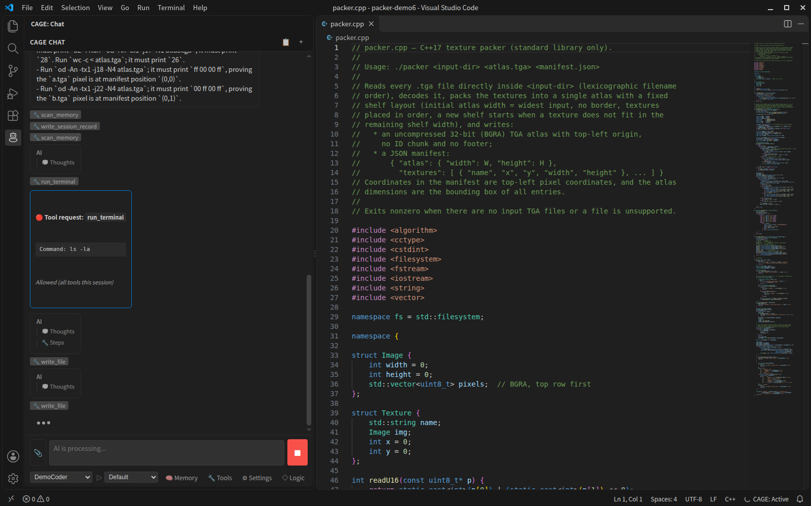

**English** · [繁體中文](chat-panel.zh-TW.md)

# Chat Panel

The chat panel lives in the CAGE container in the activity bar. It is where
you talk to the agent, and where tool calls stop for your approval.

Open it with the activity bar icon, or **CAGE: Open Chat** from the command
palette.

---

## Anatomy

| Area | What it is |
|---|---|
| Message list | The conversation. Answers stream in token by token |
| Input box | Your message. Enter sends, Shift+Enter adds a line |
| 📎 Attach | Picks files to send with this message — see [below](#attaching-files) |
| Graph selector | Which logic graph answers you — see [below](#the-two-selectors) |
| Start selector | Which entry point in that graph the run begins at |
| 🧠 Memory | The project's memory routing table — see [Project Memory](memory.md) |
| 🔧 Tools | What the model is offered and how each tool behaves — see [Tools](tools.md) |
| ⚙ Settings | Opens the extension's settings — see [Settings](settings.md) |
| ◇ Logic | Opens the [Logic Editor](logic-editor.md) |
| Session buttons (top right) | History panel, and new session |
| Status chip (status bar) | `CAGE: Idle`, `Connecting...`, the model's name while it answers, `Disconnected`, or an error |

## A folder must be open

Nothing is sent until a folder is open in the editor. Without one, a file the
model writes has nowhere to go but the editor's own working directory, and the
index, project memory and session record have nowhere to live. A note above the
input box offers **Open Folder…** instead; what you typed and attached stays put.
The native client does the same and points you at ≡ → **Open Folder…**.

## Attaching files

📎 beside the input box picks one or more files. They upload immediately and
appear as chips above the input; ✕ on a chip drops it. The chips clear when you
send — attachments belong to a single message, not to the session.

What reaches the model depends on the graph. The files arrive on the Start
node's `ASSET` output, so they only reach the nodes you wired that output to.
A [Send To AI](nodes.md#send-to-ai) node with an asset input running a
vision-capable model sees the images themselves; one running a text-only model
gets the file list instead, and a modality node uses the file as its source
image. A graph whose `ASSET` pin goes nowhere ignores attachments entirely —
that is the wiring, not a failure.

You can send an attachment with no text at all.

## The two selectors

The pair of dropdowns at the bottom decides what actually runs.

**Graph** picks the logic graph to run: any graph in this workspace, plus the
ones on the server you are allowed to use. **None ship with CAGE** — create one in
the [Logic Editor](logic-editor.md), or import one; the
[worked example](example-graph.md) walks through a complete one. With no graph
selected, a message is answered with an error rather than run some other way.
When this workspace has no graph yet but the server has some, the first of them
is selected and downloaded; if that fails, the selector shows *(pick a graph)*
instead of looking as if one were chosen.

Your selection travels with the message itself, so it is what the server
executes for that message; there is no separate session binding that can drift
out of step with the dropdown.

**Start** picks the entry point. A graph always has a `Default` Start node, and
may have more; each has a name. Choosing a different Start runs the same graph
from a different place — for example a "plan only" entry alongside the full
coding flow. See [Start](nodes.md#start).

A `↓` beside a graph name means the graph exists on the server but not yet in
this workspace; selecting it downloads it.

## Sessions

A session is one conversation with its own message history and its own
approval state.

- **New Session** clears the conversation, resets session-level tool
  approvals (see [Tools](tools.md)) and starts a new
  [session record](memory.md#the-session-record-written-automatically).
- A session outlives a server restart: the conversation keeps its session. Only
  a new chat, loading another conversation from History, or a server that has
  no record of the session changes it.
- **Loading a conversation from History continues it.** It becomes the current
  conversation, in its own session, so the next message carries on where it
  left off — its session record included.
- Each completed exchange is saved to history automatically.
- The history panel lists past conversations grouped by date, with search and
  import/export. Its title is the opening words of your first message.

The history in this panel is stored by VSCode on your machine. The server keeps
its own record of each session when it has a database — for token accounting,
and so that a session can be picked up again after a restart.

## Tool approval

When the model asks to run a tool, the request appears inline in the
conversation with four choices: allow once, allow this tool for the session,
allow everything for the session, or deny. Approval is covered in
[Tools](tools.md).

## Reviewing changes

Each file a tool is about to write appears as its own card, with the unified
diff against what is on disk, syntax-coloured. Approve it and the file is
written; decline it and nothing happens and the model is told. Only one card
waits on you at a time — the rest queue behind it. See
[File Approval](file-approval.md).

## Interim steps

A graph often makes several model calls before it produces the answer you asked
for. Those intermediate messages are collapsed into a **Steps** block you can
expand, so a long tool-calling run does not bury the actual reply.

## Connection behaviour

The client does not hold a socket open. It connects when you send a message,
stays connected for the whole exchange, and disconnects when the exchange ends.
Attachments are uploaded separately, over HTTP, when you pick them. A dropped connection during a run surfaces on the status
chip and in the panel.

---

Next: [Logic Editor](logic-editor.md) · [Tools](tools.md) · [Settings](settings.md)

[← Client Guide](README.md)
