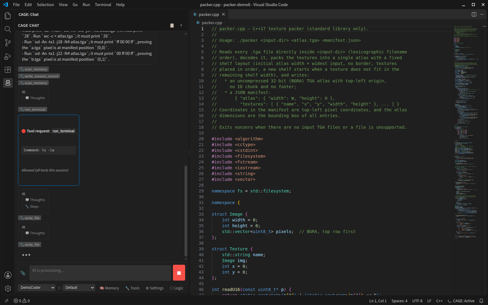

[English](chat-panel.md) · **繁體中文**

# Chat Panel

chat panel 在活動列的 CAGE 容器裡。你在這裡跟 agent 對話，工具呼叫也在這裡停下來等你核准。

用活動列的圖示打開，或從 command palette 執行 **CAGE: Open Chat**。

---

## 構成

| 區域 | 是什麼 |
|---|---|
| 訊息清單 | 對話內容。回答一個 token 一個 token 串流進來 |
| 輸入框 | 你的訊息。Enter 送出，Shift+Enter 換行 |
| 📎 Attach | 挑選要跟這則訊息一起送出的檔案，見[下方](#附加檔案) |
| Graph 選單 | 由哪一張邏輯圖回答你，見[下方](#兩個選單) |
| Start 選單 | 這一輪從那張圖的哪個入口開始 |
| 🧠 Memory | 這個專案的記憶路由表，見[專案記憶](memory.zh-TW.md) |
| 🔧 Tools | 提供給模型哪些工具、每個工具怎麼運作，見 [Tools](tools.zh-TW.md) |
| ⚙ Settings | 打開這個 extension 的設定，見[設定](settings.zh-TW.md) |
| ◇ Logic | 打開 [Logic Editor](logic-editor.zh-TW.md) |
| Session 按鈕（右上角） | 歷史紀錄面板，以及新 session |
| 狀態標籤（狀態列） | `CAGE: Idle`、`Connecting...`、回答期間顯示模型名稱、`Disconnected`，或錯誤訊息 |

## 一定要開著資料夾

編輯器裡沒有開資料夾的話，什麼都不會送出。沒有資料夾，模型寫的檔案只能落在編輯器自己的工作目錄，索引、專案記憶和 session 紀錄也沒有地方放。這時輸入框上方會出現一則提示，提供 **Open Folder…**；你打的字和附加的檔案都會留著。native client 也一樣，會提示你從 ≡ → **Open Folder…** 開啟。

## 附加檔案

輸入框旁的 📎 可以挑一個或多個檔案。檔案會立刻上傳，以標籤的形式出現在輸入框上方；按標籤上的 ✕ 可以拿掉。送出之後標籤就會清空：附加檔案屬於單一則訊息，不屬於整個 session。

模型收到什麼，取決於邏輯圖。檔案從 Start 節點的 `ASSET` 輸出送出，所以只會送到你接了這個輸出的節點。有 asset 輸入、跑的是看得懂圖片的模型的 [Send To AI](nodes.zh-TW.md#send-to-ai) 節點，看到的是圖片本身；跑純文字模型的，拿到的是檔案清單；modality 節點則把檔案當成來源圖片。`ASSET` pin 沒有接到任何地方的圖，會完全忽略附加檔案 —— 那是接線的結果，不是故障。

也可以只送附加檔案、完全不打字。

## 兩個選單

底部的兩個下拉選單，決定實際上要執行什麼。

**Graph** 選擇要執行的邏輯圖：這個工作區裡的任何一張，加上 server 上你有權使用的。**CAGE 沒有附任何邏輯圖**：在 [Logic Editor](logic-editor.zh-TW.md) 裡建一張，或匯入一張；[完整範例](example-graph.zh-TW.md)完整走過一張。沒有選圖的話，訊息會得到一個錯誤，而不是用別的方式執行。

你的選擇會跟著訊息一起送出，所以 server 處理這則訊息時執行的就是它；沒有另外一份綁在 session 上、可能跟選單對不上的設定。

**Start** 選擇入口。一張圖一定有一個 `Default` Start 節點，也可以有更多，每個都有名字。選不同的 Start，就是從不同的地方執行同一張圖 —— 例如在完整的 coding 流程旁邊，多一個「只做規劃」的入口。見 [Start](nodes.zh-TW.md#start)。

圖名旁邊有 `↓` 的，表示這張圖在 server 上有、但這個工作區裡還沒有；選它就會下載下來。

## Session

一個 session 就是一段對話，有自己的訊息歷史和自己的核准狀態。

- **New Session** 會清空對話、重設 session 層級的工具核准（見 [Tools](tools.zh-TW.md)），並開始一份新的 [session 紀錄](memory.zh-TW.md#自動寫下的-session-紀錄)。
- session 撐得過 server 重新啟動：對話會沿用它的 session，只有開新的對話，或 server 那邊沒有這個 session 的紀錄時，才會開另一個。
- 每完成一來一回，就會自動存進歷史紀錄。
- 歷史紀錄面板依日期分組列出過去的對話，可以搜尋、匯入與匯出。每段對話的標題是你第一則訊息開頭的幾個字。

這個面板裡的歷史紀錄由 VSCode 存在你的電腦上。server 有資料庫的話，也會替每個 session 留一份自己的紀錄，用來計算 token 用量，也讓 session 在重新啟動之後能接續下去。

## 工具核准

模型要求執行工具時，請求會直接出現在對話裡，有四個選擇：只允許這一次、這個 session 都允許這個工具、這個 session 什麼都允許，或拒絕。核准的細節寫在 [Tools](tools.zh-TW.md)。

## 檢視變更

工具準備寫入的每一個檔案，都會各自顯示成一張卡片，附上跟磁碟上現有內容比較的 unified diff，並且有語法上色。核准就寫入；拒絕的話什麼都不會發生，模型會收到通知。一次只有一張卡片等你處理，其他的排在後面。見[檔案核准](file-approval.zh-TW.md)。

## 中途的步驟

一張圖往往要呼叫模型好幾次，才產生你要的回答。這些中途的訊息會收進一個可以展開的 **Steps** 區塊，所以呼叫很多次工具的長流程，不會把真正的回覆淹沒。

## 連線方式

client 不會一直開著 socket。你送出訊息時才連線，整個一來一回期間保持連線，結束後就斷開。附加檔案則是在你挑選時，另外透過 HTTP 上傳。執行途中連線中斷的話，會顯示在狀態標籤和面板上。

---

下一步：[Logic Editor](logic-editor.zh-TW.md) · [Tools](tools.zh-TW.md) · [設定](settings.zh-TW.md)

[← Client 指南](README.zh-TW.md)
