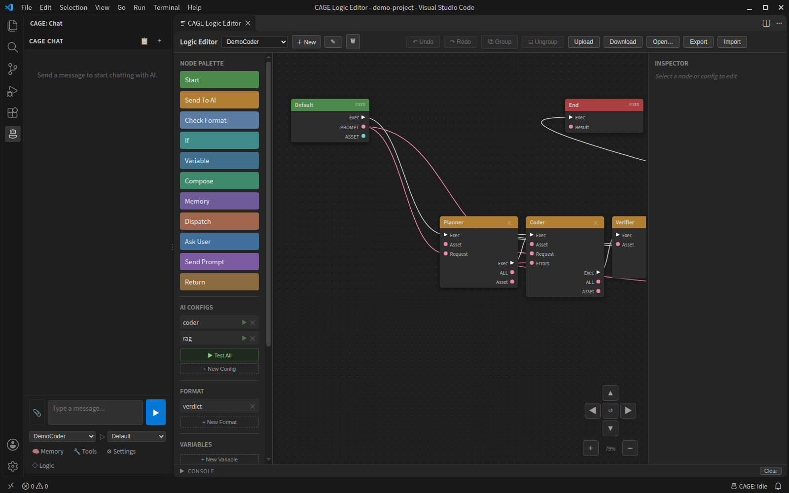
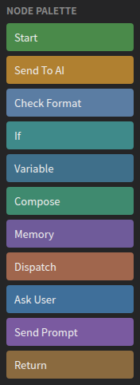

[English](logic-editor.md) · **繁體中文**

# Logic Editor

Logic Editor 是你設計 agent 要做什麼的地方。大多數助手只有一個寫死的「思考、呼叫工具、重複」迴圈，邏輯圖取代了它：步驟由你排，每一步由哪個模型執行由你決定，分支也由你自己接。

用 **CAGE: Open Logic Editor** 打開。

---

## 構成

| 區域 | 是什麼 |
|---|---|
| Graph 選單（左上） | 你正在編輯哪一張圖。`+ New` 建立新圖，垃圾桶刪除 |
| 工具列（右上） | Undo／Redo、Group／Ungroup、Upload／Download、Open／Export／Import |
| 節點面板（左側） | 拖曳或點一下就加入節點，見[節點](nodes.zh-TW.md) |
| 側欄區塊（左側下方） | 圖中節點會引用的、可以重複使用的設定 |
| 畫布（中間） | 圖本身。拖曳節點；從一個 pin 拖到另一個 pin 來連線；在空白處拖曳可以框選多個節點。滾輪縮放，按住中鍵或右鍵拖曳可以平移；右下角的按鈕兩者都能做 |
| Inspector（右側） | 目前選取項目的設定 |
| Console（底部） | 警告與結果：模型授權的標記、config 測試的輸出、載入時參數的提醒 |

## 側欄區塊

每個區塊都是一份清單，列著有名字、可以重複使用的定義。節點**依名字**引用它們，所以改名時，所有用到它的節點都會跟著更新。

| 區塊 | 定義什麼 | 詳細說明 |
|---|---|---|
| AI Configs | 一個模型，加上怎麼載入、怎麼取樣 —— 文字模型和生成式模型（圖像、語音、音訊、音樂、3D）在同一份清單裡 | [AI Configs →](ai-config.zh-TW.md) · [生成式的欄位 →](modality-config.zh-TW.md) |
| Format | 輸出的形狀：JSON、必要的鍵、regex、不可為空 | [Format Configs →](format-config.zh-TW.md) |
| Variables | 有名字、在圖的一次執行中存在的狀態 | [變數 →](variables.zh-TW.md) |
| Memory | **Memory AI Config**：負責挑選每一步要讀哪些記憶、濃縮 session 紀錄、決定要寫回什麼的模型。**Embedding Model**：把你的專案 embed 起來的 config，有了它才會開啟檢索，也用來排序檔案歷史。路由表本身屬於專案，在 Chat → 🧠 Memory | [專案記憶 →](memory.zh-TW.md) · [RAG →](rag.zh-TW.md) |

**Test All** 一次跑完每個 AI config 的連線測試。每個 config 也有自己的 ▶ 測試按鈕，會先驗證設定，再實際把模型載入 —— 想在真正依賴它之前，先知道一種擺放放不放得進 VRAM，這很有用。

## 接線

連線會帶兩種不同的東西，編輯器把它們分開處理：

- **Exec pin**（三角形）代表執行順序。一個節點做完，下一個開始。exec 只能接 exec。
- **Data pin**（圓形）帶的是值。data pin 可以接到同型別的另一個 data pin，或接到 `string`（沒有型別的通道），也可以從 `string` 接過來。
- **Asset pin**（藍綠色圓形）帶的是檔案而不是文字：聊天的附加檔案，以及產生出來的圖片、音訊、網格。它們可以互相連接、接到任何 modality 內容型別，也可以跟 `string` 互接。你加上的任何 pin，都可以在 inspector 裡切換成文字或 asset。

連線經過時可以改名：輸出 pin 的名字是送出端的鍵，輸入 pin 的名字是接收端的鍵。一個節點的 `ALL` 輸出，就是這樣變成另一個節點的 `PlanIn` 輸入。

執行從選定的 Start 節點開始，沿著 exec 連線前進。節點執行之前，會先沿著 data 連線把它的資料輸入拉過來 —— 所以 [Variable](nodes.zh-TW.md#variable) 節點可以完全不接 exec 線，單純當作值的來源。

迴圈是允許的：一條 exec 連線如果回到已經走過的節點，會清掉那個節點「已走過」的標記，再執行一次。

每一條路徑都必須結束在 [End](nodes.zh-TW.md#end) 或 [Return](nodes.zh-TW.md#return)。走著走著就沒有節點的路徑，會被回報為沒有宣告的死路。

## 群組

選取幾個節點後按 **Group**，就會收成一個有自己輸入、輸出 pin 的方框。群組可以巢狀。群組只是為了編輯方便：圖送到 server 之前會先攤平，所以分不分組永遠不會改變行為。

## 儲存與分享

編輯器會一邊編輯、一邊把圖同步到 server。如果 server 上的那份比你的新（別人改過，或是另一個視窗改過），會出現一條橫幅，讓你選 **Use server's** 或 **Keep mine and overwrite**。

其餘的由工具列處理：

| 按鈕 | 做什麼 |
|---|---|
| Upload／Download | 把這張圖推到 server，或把 server 上的那份拉下來 |
| Open… | 切換到 server 上存的另一張圖 |
| Export／Import | 把圖寫成 JSON 檔，或讀回一個 JSON 檔 |

圖有擁有者：你的圖預設是私人的，除非分享出去。分享會授予特定使用者讀取或寫入的權限，見[帳號](../server/control/accounts.zh-TW.md#每個使用者各自計量)。

---

## 接下來

- [節點](nodes.zh-TW.md)：每一種節點、它的 pin 和它的設定
- [AI Configs](ai-config.zh-TW.md)：每一個模型參數，以及它什麼時候生效
- [Format Configs](format-config.zh-TW.md)：讓模型回傳固定的形狀
- [變數](variables.zh-TW.md)：在節點之間攜帶狀態
- [RAG](rag.zh-TW.md)：把你的專案當作 context 交給節點

[邏輯圖檔案格式](graph-format.zh-TW.md) · [← Client 指南](README.zh-TW.md)
