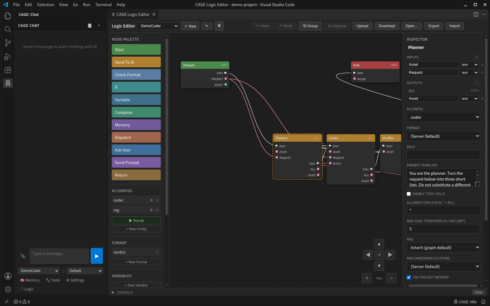

[English](nodes.md) · **繁體中文**

# 節點

邏輯圖裡的每一個步驟都是一個節點。這一頁逐一說明每種節點：它做什麼、有哪些 pin，以及選取它時 Inspector 會顯示哪些設定。

整頁會一直出現兩種 pin：

- **exec**（三角形）：執行順序。exec 只能接 exec。
- **data**（圓形）：一個值。同型別接同型別；`string` 是沒有型別的通道，什麼都能接。

標成 *user-defined* 的 pin，是你自己在 Inspector 裡加上的。節點就是這樣拿到額外的值：加一個輸入 pin，把東西接進來，再用 pin 的名字引用它。

*選取一個節點，Inspector 就會填滿：最上面是它的 pin，接著是下面說明的設定。圖中是一個 [Send To AI](#send-to-ai) 節點。*

| 節點 | 一句話說明 |
|---|---|
| [Start](#start) | 入口；把使用者的訊息交給這張圖 |
| [Send To AI](#send-to-ai) | 呼叫模型，最主要的工作節點 |
| [Check Format](#check-format) | 驗證一個字串，依結果分支 |
| [If](#if) | 依一個值或一個變數做多重分支 |
| [Variable](#variable) | 讀寫屬於整張圖的狀態 |
| [Compose](#compose) | 用範本組出一個字串 |
| [Memory](#memory) | 收集跟這項工作有關的專案記憶，給 Send To AI 節點使用 |
| [Dispatch](#dispatch) | 把工作拆成多項任務，每項任務跑一次子圖 |
| [Send Prompt](#send-prompt) | 把 prompt 交給另一張圖，再把它的結果拿回來 |
| [Ask User](#ask-user) | 問你一個問題 —— 但只在答案真的該由你決定時 |
| [Return](#return) | 刻意結束一條分支 |
| [End](#end) | 結束這一輪，回傳結果 |

---

## Start

入口。使用者的訊息從這裡進來。

一張圖一定有一個名為 `Default` 的 Start，不能刪除。你可以再加更多 Start，每個有自己的名字，在 chat panel 的 Start 選單裡挑選 —— 一張圖，好幾個入口。「只做規劃」的入口和「完整建置」的入口，可以共用下游所有的節點。

如果 server 還沒有這個專案的索引，Start 會先向 client 要一份，然後才繼續執行，讓檢索和記憶看得到專案的檔案。

| Pin | 型別 | 方向 | 意思 |
|---|---|---|---|
| `Exec` | exec | out | 在一開始觸發一次 |
| `PROMPT` | string | out | 使用者的訊息 |
| `ASSET` | asset | out | 用 📎 附在訊息上的檔案（沒有附的話是空的） |

`ASSET` 刻意是一條獨立的線：附加檔案只會送到你真正接上的節點，所以視覺模型可以看圖片，而圖的其他部分繼續用純文字工作。

| 設定 | 意思 |
|---|---|
| Start Name | 顯示在 chat panel Start 選單裡的名字。固定的那個 Start 一律是 `Default` |

---

## Send To AI

呼叫模型，把回答串流回來。大部分的圖，大部分都是這種節點。

prompt 由 **Prompt Template** 組成，`{{pin}}` 會插入從那個輸入 pin 進來的值。prompt 需要什麼（一份計畫、一個檔案、上一次的回答），就加對應的輸入 pin，再用名字引用。沒有 pin 叫這個名字時，插入的是同名的整張圖[變數](variables.zh-TW.md)。

如果節點的 **AI Config** 指定的是 [Modality Config](modality-config.zh-TW.md) 而不是 [AI Config](ai-config.zh-TW.md)，這個節點產生的就是圖片、語音、音訊、音樂或 3D 網格，而不是文字。在這個模式下，工具呼叫、檢索和結構化輸出全部略過，`ALL` 帶的是檔案路徑。

檔案從 **asset** pin 進來，不是文字 pin。節點怎麼處理它們，取決於它跑的模型：

- 看得懂圖片的模型，會在 prompt 旁邊收到真正的圖片內容；
- 純文字模型會收到一份簡短的清單，列出附了什麼、每個檔案在哪裡，所以有檔案工具的節點還是能打開它們；
- 在 modality config 底下，asset pin 會變成一個來源檔案參數 —— 圖生圖、圖生網格就是這樣拿到輸入的圖片。

在範本裡用 `{{pin}}` 引用 asset pin，展開出來的也是同一份簡短清單，永遠不會是原始的參照。

| Pin | 型別 | 方向 | 意思 |
|---|---|---|---|
| `Exec` | exec | in / out | |
| `Asset` | asset | in | 這次呼叫要用的檔案：來自 Start 的 `ASSET`，或其他節點的輸出 |
| `Memory` | string | in | 選用，自己加的。它的值不會被當成記憶區塊 —— 這個節點每次執行都自己掃記憶（見 [Memory](#memory)）。只有 template 引用 `{{Memory}}` 的地方，才會把它的值放進 prompt |
| *user-defined* | string / asset | in | 範本裡 `{{placeholders}}` 的值，或更多檔案 |
| `ALL` | string | out | 完整的回答。在 modality config 底下會變成圖片、音訊或網格的路徑清單 |
| `Asset` | asset | out | 在 modality config 底下，產生出來的檔案 —— 可以直接接到另一個節點的 asset 輸入 |
| `Summary` | string | out | 選用，跟其他輸出 pin 一樣由你加上。有的話，寫進 [session 紀錄](memory.zh-TW.md#自動寫下的-session-紀錄)和這一步檔案歷史的是它；沒有的話是 `ALL` |
| *user-defined* | string | out | 模型必須填寫的欄位。沒有設定 Format 時，會要求以 JSON 回答、每個輸出 pin 一個必填的鍵；設定了 `json_keys` 的 Format 時，則是那個 format 的每個欄位一個鍵。不管哪一種，進來時都已經拆好了 |

| 設定 | 預設值 | 意思 |
|---|---|---|
| AI Config | — | 由哪一個 [AI Config](ai-config.zh-TW.md) 或 [Modality Config](modality-config.zh-TW.md) 執行這個節點 |
| Format | — | 一個 [Format Config](format-config.zh-TW.md)。會開啟結構化輸出，模型必須照那個形狀回答 |
| Prompt Template | — | prompt 本身。`{{pinName}}` 會插入一個輸入 pin 的值；沒有 pin 叫這個名字時，插入同名整張圖變數的值 |
| Enable Tool Calls | on | 模型能不能呼叫你編輯器裡的工具 |
| Allowed Tools | `*` | 以逗號分隔的允許清單；`*` 表示 client 提供的每一個工具 |
| Max Tool Iterations | 0 | 幾則回覆可以呼叫工具，之後節點停止。一則回覆可以呼叫好幾個工具。有設時，prompt 會告訴模型這個上限。`0` 表示沒有上限：節點會一直跑到模型不再呼叫工具 |
| RAG | Inherit | `Inherit` 用整張圖的設定，`Off` 在這裡關閉檢索，`Custom` 另外挑一個 embedding config。見 [RAG](rag.zh-TW.md) |
| RAG Embedding | — | RAG 設為 Custom 時用的 config |
| Use project memory | on | 這個節點要不要讀[專案記憶](memory.zh-TW.md)。開著時，它每次執行都用整張圖的 Memory AI Config 掃一次記憶 |
| Memory: keep top-N history | 0 | 依整張圖的 RAG embedding config 算相似度，只保留跟這項工作最接近的 N 份檔案歷史。`0` 全部保留 |
| Split long input into chunks | off | prompt 遠大於模型的 context 時，分段執行，再把回答接起來。這個模式下不會解析結構化輸出 |
| Chunk preamble | — | 分段時放在每一段前面的文字 |

**一則回覆失敗時。**開著工具呼叫時，失敗的回覆 —— 模型載不起來，或生成途中出錯 —— 會顯示在這一步的 Steps 區塊和 Logic Debug，隔一秒用同樣的訊息重跑同一輪，直到成功或你按停止。失敗那一次的東西不會往下傳，這一步不會被標成失敗，重跑也不算進 Max Tool Iterations。關了工具呼叫時，失敗照舊以錯誤結束這一步。

**回覆被切斷時。**本機模型的回覆寫到 context 的盡頭而停下時，輸出最後會加一句說明，附上這次的輸入與輸出 token 數，Logic Debug 也會顯示一行錯誤。這樣的輸出是不完整的；通常的解法是把 [AI Config](ai-config.zh-TW.md) 的 Context Size 調大。

---

## Check Format

依一個 [Format Config](format-config.zh-TW.md) 驗證 `Input` 上的字串，然後分支。成功時 `Output` 把輸入原樣傳下去，並觸發 `True`；失敗時觸發 `False`。

常見的形狀是重試迴圈：`Send To AI → Check Format`，把 `False` 接回呼叫模型的那個節點，讓它再試一次。

| Pin | 型別 | 方向 | 意思 |
|---|---|---|---|
| `Exec` | exec | in | |
| `Input` | string | in | 要驗證的字串 |
| `True` | exec | out | 驗證通過 |
| `False` | exec | out | 驗證失敗 |
| `Output` | string | out | 驗證過的字串，原樣傳下去 |

| 設定 | 意思 |
|---|---|
| Format | 依哪一個 [Format Config](format-config.zh-TW.md) 驗證 |
| Custom error message | 驗證失敗時，取代預設的訊息 |

---

## If

一個 switch。依序檢查每個 case，第一個成立的觸發它的分支；都不成立就觸發 `Else`。不管走哪一條分支，`Output` 都會把輸入原樣傳下去。

每個 case 讀的是一個輸入 pin 或一個[變數](variables.zh-TW.md)，可用的運算子取決於你選的值型別：

| 值型別 | 運算子 |
|---|---|
| string | equals、not equals、is empty、is not empty、contains、not contains、starts with、ends with、matches regex |
| number | equals、not equals、is empty、is not empty、<、≤、>、≥ |
| bool | equals、not equals、is empty、is not empty、is true、is false |
| json | equals、not equals、is empty、is not empty、is valid JSON、has key、path equals |
| enum | equals、not equals、is empty、is not empty |

JSON 的 case 可以指定一個 **path**，指向文件裡的某個值。字串比較可以設成不分大小寫。

| Pin | 型別 | 方向 | 意思 |
|---|---|---|---|
| `Exec` | exec | in | |
| `Input` | string | in | 預設的比較來源 |
| `Case 1` … | exec | out | 每個 case 一個，名字由你取 |
| `Else` | exec | out | 沒有任何 case 成立 |

新增或改名 case 時，輸出 pin 會跟著更新，已經接好的連線會保留。

---

## Variable

讀寫這張圖的[變數](variables.zh-TW.md)。

每個 **item** 指定一個目標變數、一個操作和一個來源：

| 欄位 | 選項 |
|---|---|
| Operation | `set` 覆寫；`add` 附加 —— 數字相加、字串串接、bool 做 OR |
| Source | `constant` 固定值、`node` 這個節點上的一個輸入 pin、`variable` 另一個變數 |

加好幾個 item，就能在一個節點裡寫好幾個變數。

**Getter pin** 是另一半。加一個名字跟某個變數相同的輸出 pin，下游的節點就能直接從它讀到這個變數目前的值，不需要 exec 線。值是在讀取的節點執行那一刻才拉過來的，所以永遠是最新的。

| Pin | 型別 | 方向 | 意思 |
|---|---|---|---|
| `Exec` | exec | in / out | 選用 —— 純粹當 getter 的節點兩個都不需要 |
| *user-defined* | string | in | 來源為 `node` 的 item 的來源 |
| *user-defined* | string | out | Getter pin，以變數命名 |

---

## Compose

把很多字串組成一個。**Template** 是自由文字，`{{pinName}}` 插入一個輸入 pin 的值，`{{variableName}}` 插入一個[變數](variables.zh-TW.md)。

用它把幾個部分組成一個 prompt，或在一輪結束時排版一份報告。它不做任何驗證 —— 那是 [Format Configs](format-config.zh-TW.md) 的工作。

| Pin | 型別 | 方向 | 意思 |
|---|---|---|---|
| `Exec` | exec | in / out | |
| *user-defined* | string | in | 以 `{{pinName}}` 引用 |
| `Output` | string | out | 套好的字串 |

| 設定 | 意思 |
|---|---|
| Template | 文字內容，含 `{{pin}}` 和 `{{variable}}` 預留位置 |

---

## Memory

把跟一項工作有關的[專案記憶](memory.zh-TW.md)組成一段文字，給要讀這段文字的節點用。

Send To AI 節點不需要它。每個 Send To AI 每次執行都會自己掃記憶，以它自己的 prompt 當這次的工作：記憶 AI 把每一列規則、每份檔案歷史和 session 紀錄跟那段 prompt 並排來看，挑出有關的。這樣迴圈裡的步驟讀得到上一次嘗試的報告，做不同事的兩個節點也各自讀到合用的。

所以 Memory 節點只在有人讀它的文字時才組：Compose 節點的 `{{Memory}}`、名字不是 `Memory` 的 pin、template 引用了 `{{Memory}}` 的 Send To AI、執行 modality config 的節點，或關了專案記憶的 Send To AI。它餵的每個節點都是從 `Memory` pin 接收的 Send To AI 時，它輸出空字串，並在 Logic Debug 說明 —— 沒有人用的挑選就不做，省下一次模型呼叫。不管哪一種，用的都是整張圖的 Memory AI Config。

| Pin | 型別 | 方向 | 意思 |
|---|---|---|---|
| `Exec` | exec | in / out | |
| `Input` | string | in | 這項工作，通常是 Start 的 `PROMPT`。記憶 AI 拿它來判斷 |
| `Memory` | string | out | 組好的記憶區塊；沒有人讀時是空字串 |

| 設定 | 預設值 | 意思 |
|---|---|---|
| Token budget | 0 | 把區塊修剪到這麼多 token。`0` 表示不修剪。規則永遠不會被丟掉 |
| Keep top-N history | 0 | 依整張圖的 RAG embedding config 算相似度，只保留跟這項工作最接近的 N 份檔案歷史。`0` 全部保留 |

這個節點看不到自己餵的是哪個模型，所以不像 Send To AI 那樣能自己算出預算；這就是預算在這裡是一個設定的原因。

---

## Dispatch

把一個大的請求拆成一份計畫，然後每一項任務各跑一次掛在 `Step` 下面的子圖。Dispatch 本身不做事 —— 做事的是 `Step` 下游的節點。

由一個 **splitter** 模型把 `Input` 變成一棵樹：有編號的項目是依序進行的步驟，步驟裡的 `-` 項目是可以並行的任務。每一片葉子觸發一次 `Step`，任務內容在 `Task` 上，它的編號在 `Index` 上。所有任務都完成後，`End` 觸發一次，主流程接著往下。

splitter 的 prompt 是固定的，不能編輯。它的輸出在解析前會先整理過：拿掉 chain-of-thought，只讀計畫那一段，所以推理模型也能用在這裡。計畫的長度沒有上限；給 splitter 的 config 足夠的 context，放得下 prompt 和整份計畫。

| Pin | 型別 | 方向 | 意思 |
|---|---|---|---|
| `Exec` | exec | in | |
| `Input` | string | in | 要拆解的工作 |
| `Step` | exec | out | 每項任務觸發一次 |
| `Task` | string | out | 這項任務的內容 |
| `Index` | string | out | 這項任務的編號 |
| `Plan` | string | out | 解析好的整份計畫 |
| `End` | exec | out | 所有任務都完成後觸發一次 |

| 設定 | 預設值 | 意思 |
|---|---|---|
| Splitter AI Config | — | 寫計畫的模型 |
| Parallel | off | 同一個 `-` 群組裡的任務同時執行 |
| Max Parallel | 0 | 開啟 parallel 時一次跑幾個。`0` 表示沒有上限 |

---

## Send Prompt

把一個 prompt（以及任何檔案）交給**另一張圖**，再把那張圖回傳的東西拿回來。可以把它想成一個 sub-agent：這張圖決定要送什麼、拿到答案之後做什麼；另一張圖用它自己的模型和設定做事。

Dispatch 是每項任務跑一次*這張*圖的一部分。Send Prompt 是跑一次*另一張*圖。

另一張圖在同一個 session、同一條連線上執行，所以它的工具呼叫、問題和串流文字都照常送到你這裡。只有它的最終結果會被攔下來交回這裡，而不是結束你這一輪。

| Pin | 型別 | 方向 | 意思 |
|---|---|---|---|
| `Exec` | exec | in / out | |
| `Prompt` | string | in | 另一張圖收到的訊息 |
| `Asset` | asset | in | 它收到的附加檔案 |
| `Result` | string | out | 另一張圖的結果：它 End 的 `Result`；沒有的話是 `ALL`；再沒有的話是它唯一的文字值；否則把全部包成一個 JSON 物件 |
| `Asset` | asset | out | 另一張圖回傳的檔案 |

| 設定 | 預設值 | 意思 |
|---|---|---|
| Graph | — | prompt 要交給哪一張圖 |
| Entry | 空白 | 依名字指定要跑那張圖的哪一個 Start。空白就跑它的第一個 Start |
| Max Nesting Depth | 0 | 一連串 Send Prompt 呼叫最多能有幾層。`0` 表示沒有上限 |

---

## Ask User

在根據錯誤的假設做事之前，先暫停這一輪、問你一件事。

這個節點不是直接問。它會先跑一個模型，判斷到底需不需要問，而**大多數工作都不需要** —— 那才是正常、正確的結果。問題只保留給真正該由你決定的事：

- 需求有歧義，不同的理解會導致實質上不同的工作
- 缺少一個會改變設計的限制條件：目標平台、資料來源、相容性、規模
- 一個應該由你負責的取捨，因為那是產品、UX 或政策上的偏好

它刻意*不*問這些：從程式碼、請求或一般慣例就能回答的事；有明顯預設值的實作細節；或是執行工具的許可 —— 那有它自己的核准關卡。

每個問題都是自足的；可能的答案能列舉時，會附上兩到四個具體的選項。你挑一個，允許自由輸入的話也可以自己打。答案會合併在 `Answers` 上，可以直接餵進 prompt；`Asked` 告訴這張圖到底有沒有問，讓下游的 [If](#if) 可以依此分支。

如果沒有需要問的，`Answers` 是空的，`Asked` 是 `false`。有問題的話，這一輪會一直等你回答，等多久都行。

| Pin | 型別 | 方向 | 意思 |
|---|---|---|---|
| `Exec` | exec | in / out | |
| `Input` | string | in | 正在考慮的這項工作，用來判斷哪裡不清楚 |
| `Answers` | string | out | 問題與你的回答，合併在一起。沒有問的話是空的 |
| `Asked` | string | out | `"true"` 或 `"false"` |

| 設定 | 預設值 | 意思 |
|---|---|---|
| AI Config | — | 判斷要不要問的模型。這是判斷，不是寫文章 —— 它以最高 0.2 的溫度執行，讓同樣的輸入不會一下問、一下不問 |
| What counts as the user's call | — | 針對這個流程額外的判斷準則，加在內建的準則上 |
| Max Questions | 0 | 上限。`0` 表示沒有上限。它通常只問很少，或完全不問 |
| Offer "Other…" | on | 每個問題都多一個自由輸入的選項 |

把它放在 [Start](#start) 之後、昂貴的工作之前 —— 它的價值在於不要做出錯的東西。放在一個長流程的中間，會在你可能已經不記得前因後果時打斷你、要你回答。

---

## Return

刻意結束一條分支。它表示「這條路走完了」，跟走著走著就沒有節點的路徑不同 —— 後者 server 會回報為錯誤。

用在從 [Dispatch](#dispatch) 分出去的分支，以及刻意什麼都不做的 [If](#if) 分支。

| Pin | 型別 | 方向 |
|---|---|---|
| `Exec` | exec | in |

| 設定 | 意思 |
|---|---|
| Note | 這條路為什麼停在這裡。寫給下一個讀這張圖的人 |

---

## End

結束這一輪，把結果回傳給 chat panel。End 節點剛好只有一個，不能刪除。

| Pin | 型別 | 方向 | 意思 |
|---|---|---|---|
| `Exec` | exec | in | |
| `Result` | string | in | 要回傳的內容 |

End 沒有設定：送到 `Result` 的就是 chat panel 顯示的回答。

---

[← Logic Editor](logic-editor.zh-TW.md) · [完整範例](example-graph.zh-TW.md) · [邏輯圖檔案格式](graph-format.zh-TW.md) · [Client 指南](README.zh-TW.md)
