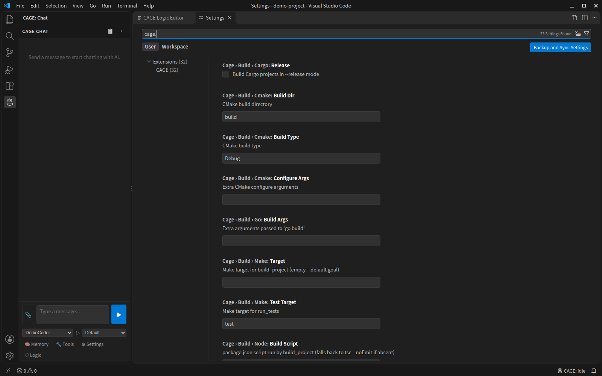

[English](settings.md) · **繁體中文**

# 設定

extension 提供的每一個設定，以它在 VSCode 設定裡 `cage.*` 底下的樣子列出。在設定介面搜尋 `cage`，或直接編輯 `settings.json`。

---

## Server 連線

| 設定 | 預設值 | 意思 |
|---|---|---|
| `cage.server.host` | `localhost` | 只填主機名稱 —— 不要加 `http://` 或 `ws://`。協定由 `tls` 決定 |
| `cage.server.port` | `15963` | 必須跟 server `config.xml` 裡的 `<port>` 一致 |
| `cage.server.tls` | `false` | 使用 `https://`／`wss://`。server 需要設定好憑證 |
| `cage.server.tlsRejectUnauthorized` | `true` | 驗證憑證。`false` 會接受自簽憑證 —— 仍然有加密，但不再能防止中途攔截 |
| `cage.server.apiKey` | 空白 | Bearer token。建議改用 **CAGE: Login**，它會替你管理 |
| `cage.server.connectRetryDelayMs` | 1000 | 每次嘗試連線之間的間隔 |

## 工具核准

見 [Tools](tools.zh-TW.md)。

| 設定 | 預設值 | 意思 |
|---|---|---|
| `cage.toolApproval.mode` | `ask` | 預設模式：`ask`、`auto`、`deny` |
| `cage.toolApproval.perTool` | `run_terminal`、`run_code`、`build_project`、`run_tests` → `ask` | 個別工具的覆寫。這裡沒有 `write_file` 和 `apply_patch`，因為它們不用這個設定：每個檔案在寫入之前都會個別核准 —— 見[檔案核准](file-approval.zh-TW.md) |

## File access

檔案工具 —— `read_file`、`write_file`、`apply_patch`、`open_file` —— 可以去哪些地方。在 chat panel 的 **⚙ Settings** 頁面也看得到。見[檔案核准 → 專案以外的檔案](file-approval.zh-TW.md#專案以外的檔案)。

| 設定 | 預設值 | 意思 |
|---|---|---|
| `cage.fileAccess.scope` | `project` | `project`：工作區資料夾加上 `allowedPaths`。`all`：這個帳號碰得到的任何地方 |
| `cage.fileAccess.allowedPaths` | `[]` | 檔案工具不必詢問也能使用的其他地方：檔案或資料夾的絕對路徑（資料夾裡的所有東西都算；`~` 是你的家目錄）。相對路徑會被忽略 |
| `cage.fileAccess.outside` | `ask` | 其他任何地方：`ask` 每次都問，只針對那一個檔案；`deny` 不詢問直接拒絕 |

三個都是機器層級的設定：專案的 `.vscode/settings.json` 改不了它們，所以 repository 沒辦法擴大工具碰得到的範圍。

## 建置與測試

給 `build_project` 和 `run_tests` 用。

| 設定 | 預設值 | 意思 |
|---|---|---|
| `cage.build.cmake.buildDir` | `build` | CMake 的建置目錄 |
| `cage.build.cmake.buildType` | `Debug` | CMake 的建置類型 |
| `cage.build.cmake.configureArgs` | 空白 | 額外的 configure 引數 |
| `cage.build.node.packageManager` | `auto` | `auto` 會從 lockfile 判斷 |
| `cage.build.node.buildScript` | `build` | `build_project` 執行的 script；沒有的話退回 `tsc --noEmit` |
| `cage.build.node.testScript` | `test` | `run_tests` 執行的 script |
| `cage.build.cargo.release` | `false` | 用 `--release` 建置 |
| `cage.build.go.buildArgs` | 空白 | 額外的 `go build` 引數 |
| `cage.build.make.target` | 空白 | Make 的 target；空白就用預設目標 |
| `cage.build.make.testTarget` | `test` | 測試用的 Make target |
| `cage.build.unity.editorPath` | 空白 | Unity Editor 的執行檔 |
| `cage.build.unity.buildTarget` | `StandaloneWindows64` | Unity 的建置目標 |
| `cage.build.unity.testPlatform` | `EditMode` | Unity 的測試平台 |
| `cage.build.unreal.enginePath` | 空白 | Unreal Engine 的安裝位置 |

## 索引

見[專案索引](indexing.zh-TW.md)。

| 設定 | 預設值 |
|---|---|
| `cage.index.enabled` | `true` |
| `cage.index.excludePatterns` | `**/node_modules/**`、`**/.git/**`、`**/build/**`、`**/dist/**` |
| `cage.index.debounceMs` | 2000 |
| `cage.index.deltaFullThreshold` | 0.4 |

## 工具

| 設定 | 預設值 | 意思 |
|---|---|---|
| `cage.mcp.tools` | `[]` | 工具表的每一列 —— 預設值，以及每個 group 跟預設不同的地方。由 Tools 頁面寫入 |
| `cage.mcp.activeGroup` | `""` | 哪個工具 group 生效。`""`＝只用預設值 |
| `cage.mcp.servers` | `[]` | 你接上的 [MCP 程式](mcp.zh-TW.md) |

## 原生加速

把一部分工作交給編譯好的 sidecar。發布的 extension 不含 sidecar，所以除非你自己建一個、把 `binaryPath` 指向它，否則不管這些設定怎麼寫，每個模組都會退回 TypeScript 的路徑。

| 設定 | 預設值 | 意思 |
|---|---|---|
| `cage.native.enabled` | `true` | 總開關。關掉表示全部走 TypeScript 的路徑 |
| `cage.native.modules` | `["logic"]` | 要轉交哪些模組。已知的有：`diff`、`patch`、`buildparse`、`transport`、`logic` |
| `cage.native.binaryPath` | 空白 | 明確指定 sidecar 的路徑；空白則自動尋找 |

## 指令

| 指令 | 用途 |
|---|---|
| `CAGE: Open Chat` | 打開 [chat panel](chat-panel.zh-TW.md) |
| `CAGE: New Session` | 開始一段新的對話，並重設 session 層級的核准 |
| `CAGE: Open Logic Editor` | 打開 [Logic Editor](logic-editor.zh-TW.md) |
| `CAGE: Open Logic Debug` | 一個節點一個節點地檢視一次圖的執行 |
| `CAGE: Rebuild Index` | 丟掉 server 上這個專案的檢索索引，把每個檔案重新做一次 embedding |
| `CAGE: Tools` | [工具表](tools.zh-TW.md) —— 內建的、你自己寫的、MCP 程式、group |
| `CAGE: Switch Tool Group` | 切換生效的[工具 group](tools.zh-TW.md#group) |
| `CAGE: Open Memory` | 專案的[路由表](memory.zh-TW.md) |
| `CAGE: Resume Interrupted Run` | 繼續上一輪 |
| `CAGE: Login` / `Logout` | 登入有帳號的 server |

---

[← Client 指南](README.zh-TW.md)
