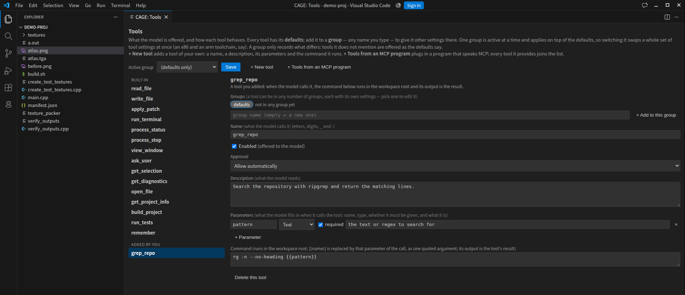

# Tools

Tool calls run **in your editor**, not on the server — every one of them. When the
model reads a file it reads your workspace; when it runs a command or a program it
runs on your machine.

Everything the model can call lives in one table, on the **Tools** page. That
includes the built-in tools, tools you write yourself and tools from an MCP
program you attached. All of them are editable in the same place and in the same
way.

Open it with **CAGE: Tools**, or the 🔧 **Tools** button under the chat box.

*One table, split by source. `grep_repo` under **Added by you** is a tool defined
entirely on this page — a name, a description, one required parameter and the
command line that runs when the model calls it.*

Which tools a node may use is set on the node — see **Enable Tool Calls** and
**Allowed Tools** in [Send To AI](nodes.md#send-to-ai).

---

## Where tools come from

The table is split into sections by source.

| Section | Named | Why it is there |
|---|---|---|
| **Built-in** | plain (`read_file`, `apply_patch`, …) | Needs the editor: your workspace, your selection, your terminal |
| **Added by you** | plain, you choose | A name, a description, a parameter list and one command line — see below |
| **One section per MCP program** | `mcp__<program>__<tool>` | A ready-made tool set you attached — see [MCP programs](mcp.md) |
| **Not currently provided** | — | Tools the table knows about that are switched off, or whose program is not connected |

The `mcp__` prefix is also how a call is routed back to the right program.

The server keeps no fixed tool list of its own. What a model is offered is
exactly what the connected client declares, which is what this table says.

## The built-in tools

| Tool | Approval | What it does |
|---|:---:|---|
| `read_file` | auto | Reads a file from your workspace |
| `write_file` | [per file](file-approval.md) | Writes a file, after you approve that file |
| `apply_patch` | [per file](file-approval.md) | Applies a unified diff, asking once per file it touches |
| `run_terminal` | **ask** | Runs a shell command. Can run in the background and return a process id |
| `run_code` | **ask** | Runs a short program the model writes, to check a result — see [below](#checking-results-with-run_code) |
| `process_status` | auto | Status and buffered output of a background process |
| `process_stop` | auto | Terminates a background process |
| `view_window` | auto | Reads the rendered image of one application window so a vision model can check what a running GUI actually displays |
| `ask_user` | auto | Puts a question to you and waits for the answer |
| `get_selection` | auto | The current editor selection |
| `get_diagnostics` | auto | Errors and warnings from the language server |
| `open_file` | auto | Opens a file, optionally at a line |
| `get_project_info` | auto | Detected project type and metadata |
| `remember` | auto | Records one durable note about a source file — why something was done, not what changed. Read again in later runs when the memory AI picks that file's history |
| `build_project` | **ask** | Builds with the detected build system |
| `run_tests` | **ask** | Runs the project's tests |

Build and test understand CMake, Unity, Unreal, Node, Cargo, Go and Make. Which
one runs is detected from the workspace; the specifics are configurable in
[Settings](settings.md).

`ask_user` is deliberately approval-exempt — asking your permission to ask you a
question would prompt twice for one interaction.

`view_window` reads a single named window, not the display, and is meant for one
job: launch a GUI with `run_terminal(background:true)`, have a vision model
confirm the window shows what it should, then `process_stop`.

The server also drives two hidden tools as part of [project memory](memory.md):
`scan_memory`, which reads the memory files, and `write_session_record`, which
appends to and condenses the session record. Neither is offered to the model,
neither asks for approval, and this table does not govern them. They do show up
as tool cards in the chat.

`.cage/` is off limits to the file tools. `read_file`, `write_file`,
`apply_patch` and `open_file` refuse any path inside it, and a patch that touches
it is not applied at all — not even to its other files. What a step gets from
project memory is chosen by the memory AI, and notes are written with
`remember`; a model reading the session record on its own would go around that
choice. `run_terminal` and `run_code` run real programs in your workspace and
cannot be held to this: `run_terminal`'s description asks the model to leave
`.cage` out of searches, and that is all.

## Writing your own tool

**+ New tool** on the Tools page. A tool you add is four things:

| | |
|---|---|
| **Name** | What the model calls. Plain, no prefix |
| **Description** | What the model is told it does. This is the whole of what it knows |
| **Parameters** | A list: name, type (text / number / true-false), required or not, description. This becomes the schema the model fills in |
| **Command** | One line, run in your workspace root. `{{name}}` is replaced by the argument the model gave |

A substituted argument is passed as **one shell argument**, never as text spliced
into the command line. The model writes those values; they do not get to become
syntax.

The result comes back the way `run_terminal`'s does, with the line that actually
ran on the first line of stderr.

Two cases are reported to the model as they are, without an approval card,
because there is nothing to approve: a required parameter it did not supply, and
a tool whose command line is still empty.

**Delete this tool** removes it along with its rows in every group.

If a name collides with a tool from another source, that source wins.

## Tools from an MCP program

**+ Tools from an MCP program** attaches a ready-made set. **List its tools**
starts it and reads its tool list; what comes back joins the table under that
program's heading. See [MCP programs](mcp.md) for the connection details.

## Checking results with `run_code`

`run_code` runs a short program the model writes, to check something: work out
the value a test should expect, parse a file the project produced, compare two
outputs byte for byte. It runs on your machine like every other tool, and asks
first, like `run_terminal`. The approval card shows the whole program.

- **The source goes to a temporary folder outside your workspace**, and is
  deleted afterwards. It does not clutter the project or end up in the index.
- **The program runs in your workspace root**, so a relative path in it reaches
  the project's files. The first line of its stderr says where it ran.
- **Compiled languages are compiled first**, in the temporary folder. A compile
  error goes back to the model as it is, and nothing runs.
- **It uses what you have installed.** The languages are python, javascript,
  bash, sh, ruby, php, c, cpp, rust and go, each through its usual program on
  your `PATH`: `python3` (`python` on Windows), `node`, `bash`, `sh`, `ruby`,
  `php`, `cc`, `c++`, `rustc`, `go`. When one is missing the model is told which
  program was not found.
- **It is not a sandbox.** The program runs as you, with your permissions — the
  reason it asks.
- **No time limit.** Stopping the run stops the program.

It is not meant for building or running the project itself. Its description
points the model at `build_project`, `run_tests` and `run_terminal` for that.

## Groups

A **group is a switchable set of tool settings**. The name is yours; it has
nothing to do with where a tool came from.

- **One group is active at a time.** Switch it on the Tools page or with
  **CAGE: Switch Tool Group**.
- **A group records only its differences.** A field you did not set follows the
  default; a tool with no row at all is offered exactly as the default says.
  To drop a tool in one group, disable it in that group.
- **A tool can be in any number of groups, with its own settings in each.** Every
  tool's form has a **Groups** row: the groups it is in, and **+ Add to this
  group** to put it in another.

Order of precedence: the active group's row, then the default row, then the
built-in rules (write tools ask per file, `ask_user` and `remember` are
automatic), then the global mode.

## What you can set on a tool

| Field | Meaning |
|---|---|
| **Enabled** | Whether it is offered to the model. A disabled tool is not declared; if the model calls it anyway it gets an error and no approval card appears |
| **Approval** | `auto` / `ask` / `deny` |
| **Description** | What the model is told. Empty means the tool's own text |
| **Custom behaviour** + **Command** | Do not run the tool's real implementation — run this command line in your workspace root instead. `{{name}}` substitution works as above |

Custom behaviour is how you redirect a built-in or an MCP tool without replacing
it: same name, same parameters, your command. A group can override just the
command line, so one tool can behave differently per group.

Three places consult this table and they are the same code: the tool list
declared to the server, the approval decision, and what actually executes.

## The write tools have their own gate

`write_file` and `apply_patch` do not use `cage.toolApproval.perTool` at all.
Every file they touch is approved individually, immediately before it is
written, with that file's diff in front of you. There is no setting that makes
them automatic.

Approvals are serialised into one queue shared with tool approval, so only one
question waits on you at a time. See [File Approval](file-approval.md).

## Risk levels

Shown on the approval card to help you decide quickly:

| Level | Tools |
|---|---|
| 🔴 High | `run_terminal`, `run_code` |
| 🟡 Medium | `build_project`, `run_tests` |
| 🟢 Low | everything else |

`run_terminal` and `run_code` are the ones that genuinely reach outside. They run
a real command or program on your machine, in your workspace root — it can reach
the network, install packages, and touch paths that no file gate sees. A tool you
wrote yourself, and a tool with custom behaviour, run a command line the same
way.

## Approving

Requests appear inline in the chat panel with four choices:

| Choice | Scope |
|---|---|
| Allow | This call only |
| Allow this tool | Every later call to this tool, until the session ends |
| Allow all | Every later tool call, until the session ends |
| Deny | Refuses; the model is told and carries on |

Session grants reset with **New Session** — that is the way back if you allowed
more than you meant to.

A request waits until you answer it. There is no timer.

## Approval modes

| Setting | Default | Meaning |
|---|---|---|
| `cage.toolApproval.mode` | `ask` | Default for every tool |
| `cage.toolApproval.perTool` | `run_terminal`, `run_code`, `build_project`, `run_tests` → `ask` | Per-tool overrides. This is where the Tools page writes the default group's approval |

`auto` for everything means a model can run arbitrary commands on your machine
without asking. Reasonable in a scratch workspace; a poor trade in a repository
you care about.

## Command output

Output comes back whole. There is no size threshold, no truncation and no
command timeout — a long build is a long build, and a background process started
with `run_terminal(background:true)` runs until you stop it.

## Where the settings live

| | |
|---|---|
| `cage.mcp.tools` | Every row of the table — the defaults and each group's differences |
| `cage.mcp.activeGroup` | Which group is active |
| `cage.mcp.servers` | The MCP programs you attached |
| `cage.toolApproval.perTool` | The default group's approval, kept in its original setting |

Changing any of them re-declares the tool list on the next connection.

---

[← Chat Panel](chat-panel.md) · [File Approval](file-approval.md) · [MCP programs](mcp.md) · [Settings](settings.md) · [Client Guide](README.md)
