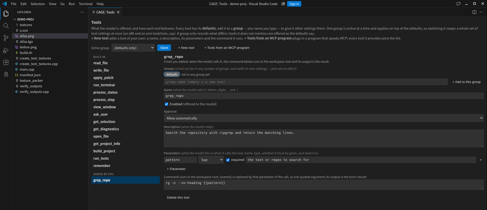

[English](tools.md) · **繁體中文**

# Tools

工具呼叫**在你的編輯器裡**執行，不是在 server 上 —— 每一個都是。模型讀檔案，讀的是你的工作區；模型執行指令或程式，是在你的機器上執行。

模型能呼叫的所有東西，都收在 **Tools** 頁面的一張表裡，包括內建工具、你自己寫的工具，以及你接上的 MCP 程式提供的工具。全部都在同一個地方、用同一種方式編輯。

用 **CAGE: Tools** 打開它，或按 chat 輸入框下方的 🔧 **Tools** 按鈕。

*一張表，依來源分區。**Added by you** 底下的 `grep_repo` 是完全在這個頁面上定義的工具 —— 一個名字、一段說明、一個必要參數，以及模型呼叫它時執行的那一行指令。*

一個節點可以用哪些工具，在節點上設定 —— 見 [Send To AI](nodes.zh-TW.md#send-to-ai) 的 **Enable Tool Calls** 和 **Allowed Tools**。

---

## 工具從哪裡來

這張表依來源分成幾個區塊。

| 區塊 | 名稱 | 為什麼在這裡 |
|---|---|---|
| **Built-in** | 不加前綴（`read_file`、`apply_patch`…） | 需要編輯器才能做：你的工作區、你的選取範圍、你的終端機 |
| **Added by you** | 不加前綴，由你取名 | 一個名字、一段說明、一份參數清單和一行指令 —— 見下方 |
| **每個 MCP 程式一個區塊** | `mcp__<program>__<tool>` | 你接上的一組現成工具 —— 見 [MCP 程式](mcp.zh-TW.md) |
| **Not currently provided** | — | 表裡有、但被關掉的工具，或它的程式沒有連上 |

`mcp__` 前綴也是把呼叫送回正確程式的依據。

server 自己沒有固定的工具清單。提供給模型的，就是連線中的 client 宣告的那些，也就是這張表寫的那些。

## 內建工具

| 工具 | 核准 | 做什麼 |
|---|:---:|---|
| `read_file` | auto | 從你的工作區讀一個檔案 |
| `write_file` | [逐檔](file-approval.zh-TW.md) | 寫一個檔案，要你先核准那個檔案 |
| `apply_patch` | [逐檔](file-approval.zh-TW.md) | 套用一份 unified diff，碰到的每個檔案各問一次 |
| `run_terminal` | **ask** | 執行一道 shell 指令。可以在背景執行，回傳一個 process id |
| `run_code` | **ask** | 執行模型寫的一小段程式，用來檢查結果 —— 見[下方](#用-run_code-檢查結果) |
| `process_status` | auto | 背景程序的狀態和緩衝起來的輸出 |
| `process_stop` | auto | 結束一個背景程序 |
| `view_window` | auto | 讀取某一個應用程式視窗繪出的影像，讓視覺模型確認執行中的 GUI 實際顯示了什麼 |
| `ask_user` | auto | 問你一個問題，等你回答 |
| `get_selection` | auto | 編輯器目前的選取範圍 |
| `get_diagnostics` | auto | language server 回報的錯誤與警告 |
| `open_file` | auto | 打開一個檔案，可以指定行號 |
| `get_project_info` | auto | 偵測到的專案類型與中繼資料 |
| `remember` | auto | 為一個原始檔記下一則長期有效的筆記 —— 記為什麼這樣做，不是記改了什麼。之後的執行裡，記憶 AI 挑中那個檔案的歷史時會再讀到 |
| `build_project` | **ask** | 用偵測到的建置系統建置 |
| `run_tests` | **ask** | 執行專案的測試 |

建置和測試認得 CMake、Unity、Unreal、Node、Cargo、Go 和 Make。跑哪一個是從工作區偵測出來的；細節可以在[設定](settings.zh-TW.md)裡調整。

`ask_user` 刻意不需要核准 —— 問你要不要讓它問你一個問題，等於一次互動跳出兩次詢問。

`view_window` 讀的是一個指定名字的視窗，不是整個畫面，而且只為一件事設計：用 `run_terminal(background:true)` 啟動一個 GUI，讓視覺模型確認視窗顯示的內容對不對，然後 `process_stop`。

server 也會在[專案記憶](memory.zh-TW.md)裡驅動兩個隱藏的工具：讀記憶檔案的 `scan_memory`，以及附加、濃縮 session 紀錄的 `write_session_record`。兩個都不提供給模型、都不要求核准，也不受這張表管理。它們還是會以工具卡片的形式出現在 chat 裡。

檔案工具碰不到 `.cage/`。`read_file`、`write_file`、`apply_patch` 和 `open_file` 會拒絕裡面的任何路徑，碰到它的 patch 會整份不套用 —— 連 patch 裡其他檔案也不套用。一個步驟從專案記憶拿到什麼，由記憶 AI 挑選，筆記則用 `remember` 寫；模型自己去讀 session 紀錄，就繞過了這個挑選。`run_terminal` 和 `run_code` 會在你的工作區裡執行真正的程式，沒辦法用這條規則管住：`run_terminal` 的說明會請模型搜尋時避開 `.cage`，也就只有這樣。

## 自己寫一個工具

在 Tools 頁面按 **+ New tool**。你新增的工具由四樣東西組成：

| | |
|---|---|
| **Name** | 模型呼叫時用的名字。不加前綴 |
| **Description** | 告訴模型它做什麼。模型對這個工具的了解就只有這些 |
| **Parameters** | 一份清單：名字、型別（文字／數字／是非）、是否必要、說明。這會變成模型要填的 schema |
| **Command** | 一行指令，在工作區的根目錄執行。`{{name}}` 會換成模型給的引數 |

代換進去的引數會以**一個 shell 引數**傳遞，絕不會當成文字拼進指令列。這些值是模型寫的，不能讓它們變成語法。

結果的回傳方式跟 `run_terminal` 一樣，stderr 的第一行是實際執行的那一行指令。

有兩種情況會直接回報給模型、不出現核准卡片，因為沒什麼好核准的：模型沒給必要參數，以及工具的指令列還是空的。

**Delete this tool** 會刪掉它，連同它在每個 group 裡的設定。

如果名字跟其他來源的工具撞名，以其他來源為準。

## MCP 程式提供的工具

**+ Tools from an MCP program** 可以接上一組現成的工具。**List its tools** 會啟動它並讀取它的工具清單；回來的工具會加進表裡，放在那個程式的標題底下。連線細節見 [MCP 程式](mcp.zh-TW.md)。

## 用 `run_code` 檢查結果

`run_code` 執行模型寫的一小段程式，用來檢查某件事：算出一個測試應該預期的值、解析專案產生的檔案、逐位元組比較兩份輸出。它跟其他工具一樣在你的機器上執行，也跟 `run_terminal` 一樣會先問你。核准卡片上會顯示整段程式。

- **原始碼放在工作區以外的暫存資料夾**，用完就刪。不會弄亂專案，也不會進索引。
- **程式在工作區的根目錄執行**，所以裡面的相對路徑能碰到專案的檔案。stderr 的第一行會說明它在哪裡執行。
- **編譯式語言會先編譯**，在暫存資料夾裡進行。編譯錯誤會原樣回給模型，什麼都不執行。
- **它用的是你裝好的東西。** 支援的語言有 python、javascript、bash、sh、ruby、php、c、cpp、rust 和 go，各自透過你 `PATH` 上常用的那支程式執行：`python3`（Windows 上是 `python`）、`node`、`bash`、`sh`、`ruby`、`php`、`cc`、`c++`、`rustc`、`go`。少了哪一個，模型會被告知找不到哪支程式。
- **它不是沙箱。** 程式以你的身分、用你的權限執行 —— 這就是它要先問你的原因。
- **沒有時間限制。** 停止這次執行，程式就會停止。

它不是用來建置或執行專案本身的。它的說明會引導模型改用 `build_project`、`run_tests` 和 `run_terminal` 做那些事。

## Group

**group 是一組可以整組切換的工具設定。** 名字由你取，跟工具從哪裡來無關。

- **同一時間只有一個 group 生效。** 在 Tools 頁面切換，或用 **CAGE: Switch Tool Group**。
- **group 只記它跟預設不同的地方。** 你沒設定的欄位照預設值；完全沒有設定列的工具，就照預設值提供。要在某個 group 裡拿掉一個工具，就在那個 group 裡把它停用。
- **一個工具可以屬於任意多個 group，在每個 group 裡各有自己的設定。** 每個工具的表單都有一列 **Groups**：列出它屬於哪些 group，以及把它加進另一個 group 的 **+ Add to this group**。

優先順序：生效中 group 的設定，再來是預設的設定，再來是內建規則（寫入工具逐檔詢問，`ask_user` 和 `remember` 自動允許），最後是全域模式。

## 一個工具可以設定什麼

| 欄位 | 意思 |
|---|---|
| **Enabled** | 要不要提供給模型。停用的工具不會被宣告；模型還是呼叫它的話，會收到錯誤，也不會出現核准卡片 |
| **Approval** | `auto`／`ask`／`deny` |
| **Description** | 告訴模型的內容。空的表示用工具本身的說明 |
| **Custom behaviour** + **Command** | 不執行這個工具真正的實作 —— 改在工作區的根目錄執行這一行指令。`{{name}}` 的代換方式同上 |

自訂行為讓你能改變內建工具或 MCP 工具的行為，又不必取代它：同樣的名字、同樣的參數，執行你的指令。group 可以只覆寫指令列，所以同一個工具在不同 group 裡可以有不同的行為。

有三個地方會查這張表，而且是同一份程式碼：宣告給 server 的工具清單、核准的判斷，以及實際執行的東西。

## 寫入工具有自己的關卡

`write_file` 和 `apply_patch` 完全不看 `cage.toolApproval.perTool`。它們碰到的每個檔案都會個別核准，就在寫入之前，那個檔案的 diff 擺在你面前。沒有任何設定能讓它們自動允許。

這些核准跟工具核准共用一個佇列、依序排隊，所以同一時間只會有一個問題在等你。見[檔案核准](file-approval.zh-TW.md)。

## 風險等級

顯示在核准卡片上，幫你快速決定：

| 等級 | 工具 |
|---|---|
| 🔴 高 | `run_terminal`、`run_code` |
| 🟡 中 | `build_project`、`run_tests` |
| 🟢 低 | 其他全部 |

`run_terminal` 和 `run_code` 才是真正碰得到外面的。它們在你的機器上、在工作區的根目錄執行真正的指令或程式 —— 可以連上網路、安裝套件，也能碰到任何檔案關卡都看不到的路徑。你自己寫的工具、設了自訂行為的工具，也是用同樣的方式執行一行指令。

## 核准

請求會直接出現在 chat panel 裡，有四個選擇：

| 選擇 | 範圍 |
|---|---|
| Allow | 只有這一次呼叫 |
| Allow this tool | 之後對這個工具的每一次呼叫，直到 session 結束 |
| Allow all | 之後的每一次工具呼叫，直到 session 結束 |
| Deny | 拒絕；模型會被告知，然後繼續 |

session 層級的允許會在 **New Session** 時重設 —— 如果你允許的比原本想的多，這就是回頭的方法。

請求會一直等到你回答。沒有計時器。

## 核准模式

| 設定 | 預設值 | 意思 |
|---|---|---|
| `cage.toolApproval.mode` | `ask` | 每個工具的預設值 |
| `cage.toolApproval.perTool` | `run_terminal`、`run_code`、`build_project`、`run_tests` → `ask` | 個別工具的覆寫。Tools 頁面把預設 group 的核准設定寫在這裡 |

全部設成 `auto`，表示模型可以不經詢問就在你的機器上執行任意指令。在拿來試東西的工作區裡還算合理；在你在乎的 repository 裡，就是一筆不划算的交換。

## 指令輸出

輸出會完整回傳。沒有大小門檻、不會截斷，指令也沒有逾時 —— 建置久就是久，用 `run_terminal(background:true)` 啟動的背景程序會一直執行，直到你停止它。

## 設定存在哪裡

| | |
|---|---|
| `cage.mcp.tools` | 這張表的每一列 —— 預設值，以及每個 group 跟預設不同的地方 |
| `cage.mcp.activeGroup` | 哪個 group 生效 |
| `cage.mcp.servers` | 你接上的 MCP 程式 |
| `cage.toolApproval.perTool` | 預設 group 的核准設定，留在它原本的設定裡 |

改了其中任何一個，下一次連線時會重新宣告工具清單。

---

[← Chat Panel](chat-panel.zh-TW.md) · [檔案核准](file-approval.zh-TW.md) · [MCP 程式](mcp.zh-TW.md) · [設定](settings.zh-TW.md) · [Client 指南](README.zh-TW.md)
