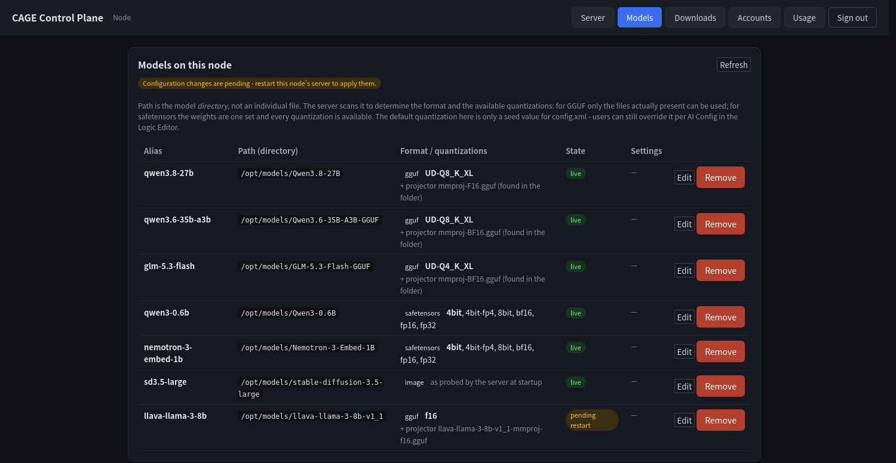

[English](README.md) · **繁體中文**

# 節點代理

`cage-launcher --agent` 是常駐在每台機器上的程序。本機的 `cage-server` 歸它管：啟動、停止、重新啟動、編輯 server 會讀的設定，以及把模型拉到本機的硬碟上。

它是唯一必須一直在跑的部分。它管理的 server 就算停了，這台機器還是管得到。

```bash
cage-launcher --agent --config /opt/cage/config.xml
```

安裝成 `cage-agent` 服務 —— 見[安裝 server](../../server-install.zh-TW.md)。

---

## 它做什麼

| 工作 | 細節 |
|---|---|
| 管理 server | 以子程序啟動 `cage-server`，停止時先送 SIGTERM 再送 SIGKILL，需要時重新啟動 |
| 回報狀態 | 透過 HTTP 問本機的 server，回答「有沒有在跑、載入了什麼、還有多少 VRAM」 |
| 編輯模型清單 | 改寫本機 `config.xml` 裡的 `<models>` —— 見[模型與下載](models.zh-TW.md) |
| 下載模型 | 從 Hugging Face 抓到本機的硬碟上，依剩餘空間在各顆硬碟之間選擇 |

在 systemd 底下，兩者會一起停止：unit 用的是 `KillMode=control-group`，所以停掉節點代理，也會停掉它啟動的 server。不在 systemd 底下就不會自動這樣 —— 只對節點代理的程序送信號，server 會繼續跑。請先透過節點代理停止 server（`POST /node/server/stop`），或對整個程序群組送信號，就像在終端機裡按 Ctrl+C 那樣。

## 設定

節點代理讀的是 server 用的同一份 `config.xml` 裡的 `<node>` 區塊：

```xml
<node>
  <server_binary>./bin/cage-server</server_binary>
  <working_dir></working_dir>
  <autostart>true</autostart>
  <bind>127.0.0.1</bind>
  <agent_port>15972</agent_port>
  <node_token></node_token>
  <download_dir>models</download_dir>
  <log_file>data/server.log</log_file>
</node>
```

| 欄位 | 意思 |
|---|---|
| `server_binary` | `cage-server` 的路徑 |
| `working_dir` | server 的工作目錄。空的＝這份檔案所在的資料夾。**不是**建置目錄 —— server 以它的 cwd 為基準解析 `data/` 和 `models/` |
| `autostart` | 節點代理一起來就啟動 server |
| `bind` / `agent_port` | 節點 API 在哪裡監聽。單機用 `127.0.0.1`；有遠端的控制台要管理它時，用一個連得到的位址 |
| `node_token` | 控制台必須出示的 Bearer。空的表示關閉驗證 —— 只有在 localhost 上才能接受 |
| `download_dir` | 下載的模型放在哪裡。重複這個元素，就能用好幾顆硬碟 |
| `log_file` | server 子程序的 stdout 和 stderr 寫到哪裡。不設的話是 `<system temp>/cage-<uid>/server.log`，只有服務帳號讀得到。不是 `/tmp` 底下的固定路徑 —— 那樣的話，別的帳號可以搶先建立它 |

`config.xml` 裡的每一條相對路徑，都以這份檔案所在的資料夾為基準解析，而不是節點代理的工作目錄 —— 所以節點代理從哪裡啟動都沒有關係。

**把節點代理綁在公開的位址、卻不設 `node_token`，等於把啟動／停止／重新啟動和模型管理，開放給任何連得到那個連接埠的人。**



*從網頁介面看到的同一條規則：橫幅和每個項目的狀態，來自拿 `config.xml` 跟執行中的 server 實際載入的內容比較。*

## 重新啟動才生效

節點代理編輯的是 `config.xml`。server 跑的是它啟動時讀到的內容。節點代理寫的任何東西，都不會送到執行中的 server。

模型清單用每個項目的狀態反映這一點：

| 狀態 | 意思 |
|---|---|
| `live` | 在設定裡，*而且*執行中的 server 已經載入 |
| `pendingRestart` | 在設定裡，但不在執行中的 server 裡 |

狀態是拿設定跟 server 回報的 alias 比較算出來的，所以是準確的，而不是靠記憶。

重新啟動 server —— 網頁介面上的一個按鈕，或 `POST /node/server/restart` —— 等待中的項目就會變成 live。

## 監看它

```bash
systemctl status cage-agent
journalctl -u cage-agent -f          # 節點代理
tail -f /opt/cage/data/server.log   # 它啟動的 server（log_file，相對於安裝位置）
```

server 自己的輸出寫到 `log_file`，不是 journal —— 節點代理會接住子程序的輸出串流，而不是直接轉送出去。

---

下一步：[模型與下載](models.zh-TW.md) · [節點 API](api.zh-TW.md) · [Server 指南](../README.zh-TW.md)
