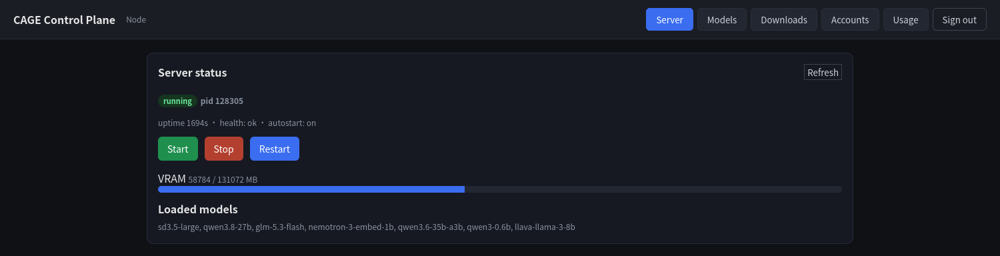
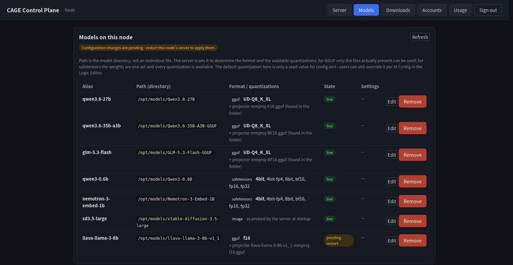

[English](README.md) · **繁體中文**

# 控制台

`cage-launcher --control` 是網頁介面，也是唯一知道不只一台機器的部分。帳號由它保管，它也透過每台機器的[節點代理](../agent/README.zh-TW.md)管理那台機器。

```bash
cage-launcher --control --control-config /opt/cage/control.xml
```

安裝成 `cage-control` 服務。打開 `http://<host>:8088/`。



*Server 分頁：程序狀態、已執行時間、健康狀況，以及執行中的 server 載入了哪些模型 —— 在這裡啟動、停止和重新啟動。*

---

## 內容

| 頁面 | 涵蓋 |
|---|---|
| [帳號](accounts.zh-TW.md) | 管理員帳號、使用者帳號、token、初始帳號，以及沒有資料庫時會怎樣 |
| [多個節點](nodes.zh-TW.md) | 加入機器、token、機器之間哪些共用、哪些不共用 |

## 它能做什麼



*Models 分頁。每個項目是 `live`（執行中的 server 已載入）或等待重新啟動 —— 只要設定和執行中的 server 不一致，就會出現橫幅。*

| 範圍 | 動作 |
|---|---|
| Server | 啟動、停止、重新啟動任何一個節點上的 server |
| 狀態 | 程序狀態、pid、已執行時間、健康狀況、VRAM、載入了哪些模型 |
| 模型 | 新增、編輯、移除一個節點 `config.xml` 裡的項目；看出哪些是 `live`、哪些是 `pendingRestart` |
| 下載 | 搜尋 Hugging Face、挑一個量化群組、下載到選定的硬碟、看進度 |
| 硬碟 | 每個下載資料夾的剩餘空間與總空間 |
| 帳號 | 建立和移除帳號、設定密碼、發 token |

它不跑推論，也不轉送 client 的流量。編輯器直接連到推論伺服器；控制台完全不在那條路上。

## 設定

```xml
<control>
  <web_port>8088</web_port>
  <bind>127.0.0.1</bind>

  <mysql>
    <host>127.0.0.1</host><port>3306</port>
    <user>cage</user><password>…</password>
    <database>cage</database><pool_size>2</pool_size>
  </mysql>

  <admin>
    <username>admin</username>
    <password>…</password>
  </admin>

  <nodes>
    <node id="local" name="local" url="http://127.0.0.1:15972" token=""/>
  </nodes>
</control>
```

| 欄位 | 意思 |
|---|---|
| `web_port` / `bind` | 介面在哪裡監聽。`0.0.0.0` 會讓它對網路開放 |
| `mysql` | 帳號資料庫 —— **必須跟 server 用的是同一個資料庫** |
| `admin` | 初始帳號。見[帳號](accounts.zh-TW.md) |
| `nodes` | 它管理的機器。見[多個節點](nodes.zh-TW.md) |

## 同一個資料庫，寫兩次

`<mysql>` 在 `control.xml` 和 `config.xml` 裡都有，而且**兩者必須指向同一個資料庫**。

兩個程序建立的是同樣的資料表 —— 使用者、token、session。讓它們指向不同的資料庫，一切看起來都沒事，直到某個 client 想登入：帳號存在於控制台的資料庫裡，server 卻從來沒聽過它。

改了一邊，就要改另一邊。

## 保護它

這個介面能啟動、停止和重新設定它知道的每一台機器。請照這個份量看待它的連接埠：

- 綁在 `127.0.0.1`，能的話透過 SSH 連進去。
- 設一個真正的管理員密碼。空的密碼會完全關閉驗證。
- 每個節點都給一個 `node_token`，不只是遠端的那些。
- 如果要對外開放，放在處理 TLS 的 proxy 後面 —— 控制台講的是一般的 HTTP。

## 節點顯示為連不到時

控制台透過 HTTP 連到節點代理，所以常見的嫌疑都是一般的網路問題：

1. 那台機器上的節點代理有沒有在跑？`systemctl status cage-agent`
2. 節點代理的 `<bind>` 允不允許遠端連線？`127.0.0.1` 不允許。
3. `<nodes>` 裡的 `token` 跟那台機器的 `<node_token>` 一不一致？
4. 連接埠連得到嗎？`curl http://<host>:15972/health`

一個節點連不到，並不代表它的推論伺服器沒在跑 —— 連在它上面的 client 會繼續正常運作。

---

[← Server 指南](../README.zh-TW.md)
