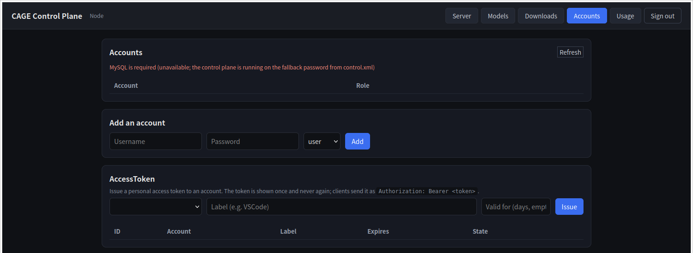

# Accounts

Who can use the server, and who can administer it. Both live in the same
database; the control plane is where they are managed.

---

## Two kinds



*The Accounts tab with no database reachable — account management is disabled
and sign-in falls back to the password in `control.xml`, exactly as described
below.*

| Kind | Used for | Stored |
|---|---|---|
| Admin | Signing in to the control plane web UI, and full access on the inference server | `users`, role `admin` |
| User | Connecting an editor to the inference server | `users`, role `user` |

Both kinds are rows of one table. Personal access tokens are kept in `api_keys`,
and the session tokens that **CAGE: Login** issues in `auth_tokens` — as hashes,
so a copy of the database cannot be replayed. An older install's `admin_users`
table is read once, to carry its accounts over into `users`.

Passwords are hashed with PBKDF2-HMAC-SHA256. Nothing stores a plaintext
password except the bootstrap entry in `control.xml`, which is why that file is
mode 600.

## The bootstrap account

```xml
<admin>
  <username>admin</username>
  <password>a-real-password</password>
</admin>
```

It does two jobs:

- **First run.** When the admin table is empty and this password is non-empty,
  this account is created. After that, manage accounts in the UI — the file is
  not read again for that purpose.
- **Fallback.** If the database is unreachable, this pair is accepted as a
  single account so you can still reach the UI and diagnose the problem.

**An empty password disables authentication.** The UI opens to anyone who can
reach the port, with full control of every node. That is a deliberate option for
a laptop install; it is not one for anything else.

## User accounts and tokens

Users are created in the UI. Each can hold personal access tokens.

A client authenticates with either:

- a **session token** from `CAGE: Login` — the normal path, managed by the
  extension; or
- a **personal access token** pasted into `cage.server.apiKey` — for
  scripted or headless clients.

Tokens are sent as a bearer on every request, which is the reason TLS matters
on anything beyond localhost: without it, every request carries a reusable
credential in the clear.

## Per-user accounting

With a database, sessions and token usage are recorded per user, so
consumption is attributable. Logic graphs are owned: a graph is visible to its
owner, to admins, and to the users it has been shared with, each with read or
write access. Sharing is done through the server's HTTP API
(`/api/logic-graph/share`, by the owner or an admin); there is no page for it
yet. A graph saved before accounts existed has no owner and is visible to
everyone.

## Running without a database

Viable for one person on one machine. Remove the `<mysql>` block from the
server's `config.xml`; the server logs:

```
[info] MySQL: no <mysql> block - running without a database (no accounts; ...)
[warning] [auth] auth DISABLED (dev-open) (users=0, masterKey=no, database=none): every request is served as admin, ...
```

There are no accounts, no per-user history, and no usage accounting. Chat
history still works — the client keeps its own.

**Security:** with no `<api_key>` either, every request is served as admin.
Anyone who can reach the server's port can read every session and change or
delete graphs. This is deliberate for a single-user trial and will not be
changed; do not use it for anything else. `<bind>127.0.0.1</bind>` in
`config.xml` keeps it to this machine.

`<api_key>` in `config.xml` is the middle ground: one shared static token, no
database, but not open either.

A `<mysql>` block whose database is not reachable is not this mode: the server
waits for the database before serving anything, so a database that starts late
never leaves it open. An account created while the server runs ends open mode
at once.

## Checklist for a shared deployment

1. Same database in `config.xml` and `control.xml`.
2. Schema loaded: `mysql -u root -p < sql/schema.sql`.
3. A real bootstrap password, then create individual accounts in the UI.
4. TLS on the inference server — tokens travel on every request.
5. `node_token` set on every agent.
6. Control plane bound to localhost or behind a TLS proxy.

---

[← Control Plane](README.md) · [Multiple nodes](nodes.md) · [Server Guide](../README.md)
