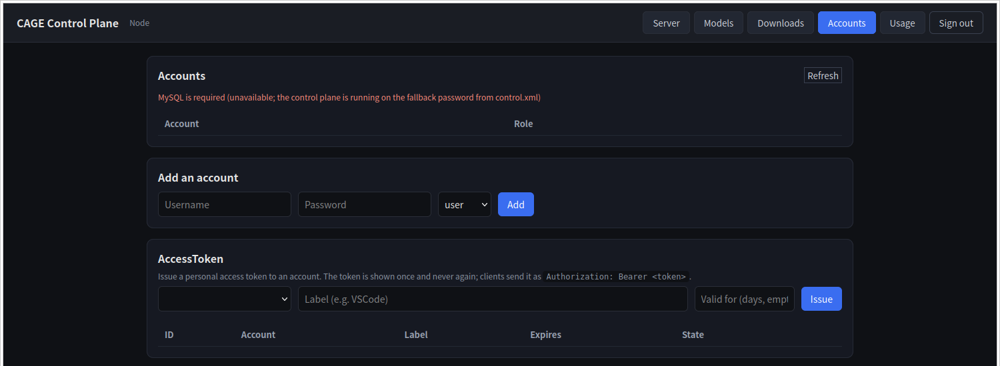

[English](accounts.md) · **繁體中文**

# 帳號

誰可以使用 server，誰可以管理它。兩者都在同一個資料庫裡，由控制台管理。

---

## 兩種帳號



*連不到資料庫時的 Accounts 分頁 —— 帳號管理被停用，登入改用 `control.xml` 裡的密碼，跟下面說的完全一樣。*

| 種類 | 用途 | 存在哪裡 |
|---|---|---|
| Admin | 登入控制台的網頁介面，並擁有推論伺服器的完整權限 | `users`，角色 `admin` |
| User | 把編輯器連到推論伺服器 | `users`，角色 `user` |

兩種都是同一張資料表裡的列。個人存取 token 放在 `api_keys`，**CAGE: Login** 發出的 session token 放在 `auth_tokens` —— 存的都是 hash，所以拿到資料庫的副本也不能拿來重放。舊版安裝的 `admin_users` 資料表會讀一次，把裡面的帳號搬進 `users`。

密碼以 PBKDF2-HMAC-SHA256 做 hash。除了 `control.xml` 裡的初始帳號，沒有任何地方存放明文密碼，這也是那個檔案權限是 600 的原因。

## 初始帳號

```xml
<admin>
  <username>admin</username>
  <password>a-real-password</password>
</admin>
```

它有兩個用途：

- **第一次執行。** 管理員資料表是空的、而這個密碼不是空的時候，會建立這個帳號。之後就在介面裡管理帳號 —— 這個檔案不會再為了這個目的被讀取。
- **備援。** 資料庫連不到的時候，這一組帳號密碼會被當成單一帳號接受，讓你還是能進到介面、診斷問題。

**空的密碼會關閉驗證。** 任何連得到那個連接埠的人都能打開介面，完全掌控每一個節點。對裝在筆電上的情況，這是刻意提供的選項；其他情況都不該這樣用。

## 使用者帳號與 token

使用者在介面裡建立。每個使用者可以擁有個人存取 token。

client 用以下其中一種方式驗證：

- **CAGE: Login** 給的 **session token** —— 一般的方式，由 extension 管理；或
- 貼進 `cage.server.apiKey` 的**個人存取 token** —— 給用腳本操作、或沒有圖形介面的 client。

token 會在每個請求裡以 Bearer 送出，這就是在 localhost 以外 TLS 很重要的原因：沒有 TLS，每個請求都以明文帶著一份可以重複使用的憑證。

## 每個使用者各自計量

有資料庫時，session 和 token 用量會依使用者記錄，所以用量能歸屬到人。邏輯圖有擁有者：一張圖對它的擁有者、管理員，以及被分享的使用者可見，每個被分享者各有讀取或寫入權限。分享要透過 server 的 HTTP API 進行（`/api/logic-graph/share`，由擁有者或管理員操作）；目前還沒有對應的頁面。在有帳號之前存的圖沒有擁有者，所有人都看得到。

## 不用資料庫執行

一個人在一台機器上用，這樣可行。從 server 的 `config.xml` 拿掉 `<mysql>` 區塊；server 的 log 會寫：

```
[info] MySQL: no <mysql> block - running without a database (no accounts; ...)
[warning] [auth] auth DISABLED (dev-open) (users=0, masterKey=no, database=none): every request is served as admin, ...
```

沒有帳號、沒有個別使用者的歷史，也沒有用量計算。聊天紀錄還是能用 —— client 會自己保存。

**安全性：** 如果也沒有 `<api_key>`，每一個請求都會以管理員身分處理。任何連得到 server 連接埠的人，都能讀取每一個 session、修改或刪除圖。這對單人試用是刻意的設計，不會改；請不要拿來做別的用途。`config.xml` 裡的 `<bind>127.0.0.1</bind>` 能把它限制在這台機器上。

`config.xml` 裡的 `<api_key>` 是中間的選擇：一個共用的固定 token，沒有資料庫，但也不是完全開放。

有 `<mysql>` 區塊、但資料庫連不到，不是這個模式：server 會等資料庫起來才開始服務，所以晚啟動的資料庫絕不會讓它處於開放狀態。server 執行期間建立了帳號，開放模式會立刻結束。

## 共用部署的檢查清單

1. `config.xml` 和 `control.xml` 用同一個資料庫。
2. 載入 schema：`mysql -u root -p < sql/schema.sql`。
3. 設一個真正的初始密碼，再到介面裡建立個別的帳號。
4. 推論伺服器開 TLS —— 每個請求都帶著 token。
5. 每個節點代理都設 `node_token`。
6. 控制台綁在 localhost，或放在 TLS proxy 後面。

---

[← 控制台](README.zh-TW.md) · [多個節點](nodes.zh-TW.md) · [Server 指南](../README.zh-TW.md)
